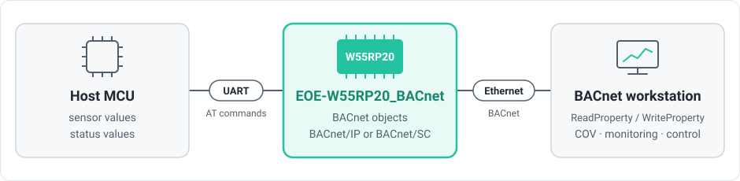
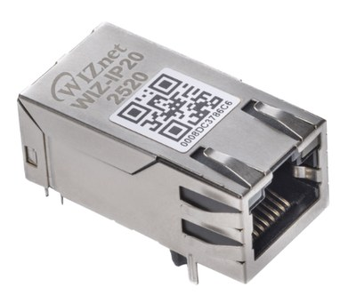
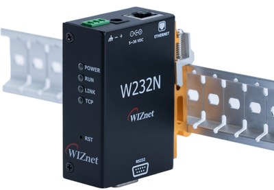
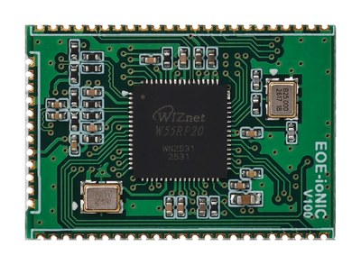

import Tabs from '@theme/Tabs';
import TabItem from '@theme/TabItem';
import AdvantageCarousel from '@site/src/components/AdvantageCarousel';
import UseCaseCards from '@site/src/components/UseCaseCards';

# EOE-W55RP20_BACnet Module

## Overview

The EOE-W55RP20_BACnet module is an embedded Ethernet module that connects your equipment to a BACnet building automation network.
It is built on the WIZnet W55RP20, which combines an RP2040 MCU and a W5500 Ethernet controller in one package.
The host MCU only exchanges AT commands over UART. BACnet protocol processing, BACnet/SC TLS encryption and certificate authentication, and TCP/IP are all handled by the module, so the host MCU does not need a BACnet stack or a network stack.



## Key Features

- BACnet/IP (Annex J) device, or BACnet/SC (Annex AB) hub connector over TLS 1.3
- ReadProperty, ReadPropertyMultiple, WriteProperty, WritePropertyMultiple, SubscribeCOV and device management services
- Up to 256 objects of nine types (Analog, Binary and Multi-state Input, Output and Value), defined with AT commands or registered at once from a CSV file
- Confirmed writes: the host MCU approves a value written from a workstation before it is applied
- 10/100 Mbps Ethernet with TCP/IP handled by the W5500 hardware, DHCP or static address, DNS
- 4 TCP/UDP channels for the host MCU, in addition to BACnet
- 56 AT commands and a web interface for every setting
- Firmware update over the web interface or UART, verified before installation
- Diagnostics, watchdog, and factory reset by AT command, web interface or pin

---

## Why EOE-W55RP20_BACnet

### When to Use

<UseCaseCards
  items={[
    {
      icon: '/img/products/EOE-ioNIC/bacnet/use-1-equipment.svg',
      title: 'Existing equipment → BMS',
      text: 'You need to connect existing equipment to a BACnet building management system (BMS)',
    },
    {
      icon: '/img/products/EOE-ioNIC/bacnet/use-2-sc-ready.svg',
      title: 'Ready for BACnet/SC',
      text: 'You are joining an existing BACnet/IP site and also need to be ready for BACnet/SC (secure BACnet)',
    },
    {
      icon: '/img/products/EOE-ioNIC/bacnet/use-3-small-mcu.svg',
      title: 'A small host MCU',
      text: 'The host MCU has no room for a BACnet stack, a TCP/IP stack or TLS',
    },
    {
      icon: '/img/products/EOE-ioNIC/bacnet/use-4-faster.svg',
      title: 'Faster development',
      text: 'You want to shorten the time spent on Ethernet hardware design and protocol testing',
    },
  ]}
/>

### Advantages

<AdvantageCarousel
  label="Advantages"
  items={[
    {
      img: '/img/products/EOE-ioNIC/bacnet/adv-1-lighter.svg',
      alt: 'Without the module, your MCU carries the BACnet stack, TLS, the TCP/IP stack and the Ethernet driver. With the module, it keeps only its application and sends values over UART.',
      title: 'A lighter host MCU',
      text: 'The module handles BACnet and TCP/IP; the host only exchanges values over UART. Even a small MCU can become a BACnet device.',
    },
    {
      img: '/img/products/EOE-ioNIC/bacnet/adv-2-bip-sc.svg',
      alt: 'One setting, AT+BACMODE, chooses BACnet/IP on the site LAN or BACnet/SC over TLS through a hub',
      title: 'BACnet/IP and BACnet/SC in one module',
      text: 'With a single setting, the same module becomes a BACnet/IP device or a BACnet/SC device that communicates over TLS through a hub. If the site moves to SC, the hardware does not need to change.',
    },
    {
      img: '/img/products/EOE-ioNIC/bacnet/adv-3-confirmed.svg',
      alt: 'A workstation writes a value, the module asks the host with +BACWRITE, the host approves with AT+BWRACK, and only then does the workstation get a SimpleACK',
      title: 'Writes the host decides',
      text: 'Objects that trigger a real action, such as a relay, can be made confirmed: when a workstation writes a value, the module asks the host MCU first and applies it only after approval. If the host refuses, the reason reaches the workstation as a BACnet error.',
    },
    {
      img: '/img/products/EOE-ioNIC/bacnet/adv-4-stable.svg',
      alt: 'Inside the W55RP20, the RP2040 runs the firmware while the W5500 handles connections, retransmission and buffering in hardware, so traffic keeps flowing to the BACnet network',
      title: 'Stable connections',
      text: 'TCP/IP is handled by the W5500 chip, not by software. Connection management, retransmission and buffering happen inside the chip, so communication continues while the firmware is busy with other work.',
    },
    {
      img: '/img/products/EOE-ioNIC/bacnet/adv-5-update.svg',
      alt: 'New firmware is verified, staged and installed at the next boot; a damaged or wrong file is refused and the running firmware stays',
      title: 'Updates that fail safely',
      text: 'New firmware is verified, held in a staging area and installed at the next boot. If the transfer is interrupted or the file is damaged, the running firmware stays in place, and firmware for another product is refused.',
    },
    {
      img: '/img/products/EOE-ioNIC/bacnet/adv-6-defaults.svg',
      alt: 'Out of the box BACnet and the web interface are off, so nothing is announced on the network, and a factory reset erases the BACnet/SC private key first',
      title: 'Safe factory defaults',
      text: 'Out of the box both BACnet and the web interface are disabled, so the module announces nothing over BACnet and opens no web server until it is configured. A factory reset erases the BACnet/SC private key first.',
    },
    {
      img: '/img/products/EOE-ioNIC/bacnet/adv-7-identity.svg',
      alt: 'The Vendor_Identifier, Vendor_Name and Model_Name of the Device object can be set to your own with AT+BACVENDOR, and the default Device instance comes from the MAC address',
      title: "Your product's identity",
      text: "The Vendor_Identifier, Vendor_Name and Model_Name a workstation reads can be set to the end-product manufacturer's values. The factory default is WIZnet's Vendor ID 1697. Each module has a unique MAC address written at the factory, and the default Device instance is derived from this MAC as well.",
    },
  ]}
/>

---

## Supported Hardware

This firmware (1.0.0) runs on the following W55RP20-based hardware. **To purchase, contact [direct@wiznet.io](mailto:direct@wiznet.io).**

<table style={{display: 'table', width: '100%', tableLayout: 'fixed'}}>
  <colgroup>
    <col style={{width: '33.33%'}} />
    <col style={{width: '33.33%'}} />
    <col style={{width: '33.33%'}} />
  </colgroup>
  <thead>
    <tr>
      <th style={{textAlign: 'center'}}><a href="/Product/Modules/Serial-to-Ethernet-Module/WIZ-IP20">WIZ-IP20</a></th>
      <th style={{textAlign: 'center'}}><a href="/Product/Modules/Serial-to-Ethernet-Module/W232N">W232N</a></th>
      <th style={{textAlign: 'center'}}><a href="/Product/Modules/EOE/EOE-W55RP20">EOE-W55RP20</a></th>
    </tr>
  </thead>
  <tbody>
    <tr>
      <td style={{textAlign: 'center'}}></td>
      <td style={{textAlign: 'center'}}></td>
      <td style={{textAlign: 'center'}}></td>
    </tr>
    <tr>
      <td style={{textAlign: 'center'}}><strong>Mag Jack module</strong><br />3.3 V TTL UART</td>
      <td style={{textAlign: 'center'}}><strong>DIN-rail converter</strong><br />RS-232 (D-SUB9)</td>
      <td style={{textAlign: 'center'}}><strong>Castellated module</strong><br />3.3 V TTL UART</td>
    </tr>
  </tbody>
</table>

---

## Feature Details

<Tabs>
<TabItem value="bip" label="BACnet/IP" default>

- Operates as a BACnet/IP (ASHRAE 135 Annex J) device. The default UDP port is 47808.
- Workstations find the device and its objects with Who-Is/I-Am and Who-Has/I-Have.
- Registers with a BBMD as a Foreign Device, for workstations on other subnets.
- Broadcasts are either subnet-directed (default) or global (255.255.255.255).

</TabItem>
<TabItem value="sc" label="BACnet/SC">

- Operates as a BACnet/SC (ASHRAE 135 Annex AB) hub connector. Because it goes through the
  hub, it communicates regardless of subnet, even across the internet or between buildings.
- Connects with WebSocket over TLS 1.3 (`wss://`), and the two sides authenticate each other
  with EC P-256 certificates.
- A primary hub and a failover hub can be registered. When the primary is lost the module
  moves to the failover hub, and when the primary comes back it returns to it.
- The private key, device certificate and issuer certificate are uploaded with AT commands or
  on the web interface. The private key never leaves the module.
- You can choose how certificate validity periods are judged while the clock is unknown
  (LENIENT / STRICT), and whether the hub certificate's name is checked.

BACnet/IP and BACnet/SC are alternatives: you choose one of the two. They are not used at the
same time.

</TabItem>
<TabItem value="services" label="BACnet Services">

- ReadProperty, ReadPropertyMultiple, WriteProperty, WritePropertyMultiple
- SubscribeCOV — 16 subscriptions, confirmed and unconfirmed notifications
- DeviceCommunicationControl, ReinitializeDevice — can be protected by a password
- TimeSynchronization, UTCTimeSynchronization
- Implements the services of the BIBBs in the BACnet Application Specific Controller (B-ASC)
  profile (DS-RP-B, DS-WP-B, DM-DDB-B, DM-DOB-B, DM-DCC-B). Protocol_Revision is 22.

</TabItem>
<TabItem value="objects" label="Objects">

An object is a single value that a workstation reads or writes, such as a temperature, a
damper position or a fan run command.

- Up to 256 objects, of which up to 64 can be commandable objects with a priority array.
- Nine types: Input, Output and Value of Analog, Binary and Multi-state.
- The Device object and the Network Port object exist from the start, so communication can be
  checked before any object is created.
- Each object is set as accepting remote writes or not, as keeping its value across reboots or
  not (PERSISTENT), and as needing the host's approval for writes or not (confirmed).
- To register many at once, upload a CSV file on the web interface. The CSV also sets
  properties such as the write range, COV increment, description and polarity.
- The host can send the Reliability along with the value. While a workstation holds an object
  Out_Of_Service, the workstation sets its value.

</TabItem>
<TabItem value="time" label="Time">

- Time comes from the workstation's TimeSynchronization, from an SNTP server, or from both.
- You set the Device's UTC_Offset. For Korea it is `UTC+09:00`.

</TabItem>
</Tabs>

<Tabs>
<TabItem value="network" label="Network" default>

- 10/100 Mbps Ethernet, with TCP/IP handled by the W5500 hardware.
- DHCP or a static address. DNS is supported.
- Besides BACnet, the host MCU has 4 TCP/UDP channels of its own. Each send carries up to
  1460 bytes, and host names can be used to connect. The Ethernet chip's sockets are shared
  with BACnet and the web, so check how many can be open at the moment with `AT+SOCKAVAIL?`.

</TabItem>
<TabItem value="management" label="Configuration & Management">

- 56 AT commands cover all settings. The module also sends unsolicited messages (URCs) when
  its state changes, for example on a remote write, a time synchronization or a hub
  connection.
- The same settings are available on the web interface, with Dashboard, Network, Identity,
  BACnet, BACnet/IP, BACnet/SC (including certificate upload), Objects, Object mapping (CSV),
  Firmware, Diagnostics, Account and Maintenance pages.
- The web interface requires a login. The password must be at least 8 characters; repeated
  wrong passwords lock the login for a while, and idle sessions expire.
- The web interface is disabled by default. Set a password over AT, then turn it on.
- AT and the web apply the same checks to the same settings, so either way gives the same
  result.

</TabItem>
<TabItem value="firmware" label="Firmware Update">

- Upload the file on the web interface, or send it over UART with an AT command.
- Received firmware is verified, held in a staging area and installed at the next boot.
- Firmware for another product, damaged files and files that are not runnable firmware are
  refused during verification.
- Settings, objects, stored values and BACnet/SC certificates are kept through an update.

</TabItem>
<TabItem value="diagnostics" label="Diagnostics">

- BACnet request counts, B/IP and SC connection state, confirmed writes and COV, time
  synchronization, sockets, storage and serial port state can be queried at once.
- If the Ethernet chip stops responding or loses its configuration, the module recovers it
  and counts how often that happened.
- If BACnet processing stalls or an Ethernet chip recovery does not finish, the watchdog
  restarts the module. The reason for the last restart can also be read as the Device's
  Last_Restart_Reason.
- Factory reset is available over AT, on the web interface and with a dedicated pin. The MAC
  address, serial number and product ID are kept.

</TabItem>
</Tabs>

---

## Documentation

This section provides the reference documentation for the module's AT command interface and its BACnet conformance.

| Title | Description | Link |
|-------|-------------|------|
| AT Command Guide | All 56 AT commands, responses, URCs and error codes |  [EN](./at-command-guide-en.md) |
| PICS | BACnet Protocol Implementation Conformance Statement (ASHRAE 135 Annex A): BIBBs, objects and properties, data links |  [EN](./pics-en.md) |

## Setup & Configuration

This section provides step-by-step guides for connecting the module, setting up BACnet and updating the firmware.

| Title | Description | Link |
|-------|-------------|------|
| Getting Started Guide | Step-by-step guide from wiring to reading a value from a workstation |  [EN](./getting-started-en.md) |
| BACnet Setup Guide | BACnet/IP and BACnet/SC setup, object definitions (AT · CSV), confirmed writes, time, Foreign Device |  [EN](./bacnet-setup-guide-en.md) |
| Firmware Update Guide | Updating the firmware through the web interface or AT commands (UART) |  [EN](./firmware-update-guide-en.md) |

---

## Specifications

| Item | Value |
|---|---|
| User objects | 256 (up to 64 of them commandable) |
| COV subscriptions | 16 |
| Confirmed writes waiting at once | 4 (host approval time 750 ms) |
| Max_APDU_Length_Accepted | BACnet/IP 1024 · BACnet/SC 1476 |
| BACnet/SC hubs | primary 1 · failover 1 |
| TCP/UDP channels | 4 (how many can be open at once: `AT+SOCKAVAIL?`) |
| Socket send size | 1460 bytes |
| AT command line | 255 bytes |

## Hardware Connections

| Signal | EOE-W55RP20 | WIZ-IP20 | W232N | I/O | Description |
|---|---|---|---|---|---|
| AT command port | GP4 (TX) · GP5 (RX) | P5 (TXD) · P3 (RXD) | DB9 3 (TXD) · 2 (RXD) | O · I | 115200 8N1 by default, no flow control |
| AT port flow control | GP6 (CTS) · GP7 (RTS) | P6 (CTS) · P10 (RTS) | DB9 8 (CTS) · 7 (RTS) | I · O | Connect only if flow control is used |
| Handshake | GP8 (DTR) · GP9 (DSR) | None | DB9 4 (DTR) · 6 (DSR) | I · O | DSR high means the module is ready for commands |
| Status outputs | GP10 · GP11 | P13 (LINKLED) · None | LINK · TCP LEDs | O | Ethernet link · TCP connection present |
| Factory reset input | FACT RSTn (GP18) | None | Switch inside the case | I | Internal pull-up. Hold low for 5 s or more to reset |
| Debug console | GP0 (TX) · GP1 (RX) | None | None | O · I | 921600 8N1, separate from the AT port |

- The W232N's DB9 is at RS-232 level. The EOE-W55RP20 and WIZ-IP20 pins are 3.3 V TTL.
- The WIZ-IP20's P13 (LINKLED) and P1 (ACTLED) are the link and activity LED signals driven
  directly by the Ethernet chip, and they are **low** when lit (GP10 and GP11 are high). The
  WIZ-IP20 has no DTR/DSR pins, so DTR/DSR flow control cannot be used on it.
- The AT port speed can be set from 9600 to 921600 bps.
- Flow control: none, RTS/CTS, DTR/DSR or XON/XOFF. To send binary data such as a certificate
  or firmware, the port must use 8 data bits and a flow control other than XON/XOFF.
- For power, operating temperature, dimensions and other electrical and mechanical
  specifications, see the module hardware datasheet.

---

## Quick Start

1. Connect the AT port at 115200 8N1, send `AT` and check that `OK` comes back.
2. Set the address. Choose DHCP or static with `AT+NETMODE`, then apply it with `AT+SAVE`.
3. Turn on BACnet. Set the mode and the Device instance with `AT+BACMODE=BIP` and `AT+BACDEV`,
   and do not forget `AT+SAVE`.
4. Check that the device appears in the workstation, then create objects and send values.

:::note
From the factory the module uses the static IP `192.168.11.2` and BACnet is off
(`AT+BACMODE?` → `+BACMODE:OFF,STOPPED`). In this state the module does not answer Who-Is at
all, so BACnet must be turned on before you look for the device from a workstation. It is the
step most often missed on a first connection.
:::

For example, publishing a temperature value over BACnet looks like this:

```text
AT+BACMODE=BIP                                         turn on BACnet/IP (once)
AT+BOBJADD=AI,1,"Supply Temp",degrees-celsius          create an Analog Input object (once)
AT+SAVE                                                store the settings and objects
AT+BOBJVAL=AI,1,21.5                                   update the value
```

A workstation reading the Present_Value of `analog-input,1` now gets `21.5`. When the value
changes, send `AT+BOBJVAL` again; the module reports the new value to every workstation that
has subscribed to COV.

The full procedure is in the [Getting Started Guide](./getting-started-en.md).

---

## Customization Services

WIZnet offers customization services for your specific needs.
Based on the EOE-W55RP20_BACnet module, the following can be changed or added to suit your application:

- Changing the factory defaults
- Changing the MAC address
- Preloading the end-product manufacturer's identity (Vendor ID, company name and model name) and object set
- Adding protocols
- Adding functions

The customized firmware is programmed into the W55RP20 and delivered.

To request customization, fill in the [customization service request form](https://docs.google.com/forms/d/e/1FAIpQLSeCPWT3H8xomuhpqjs4HJ1GzPzSn3e0yEKtTvW3RjVjMWpe1g/viewform).
