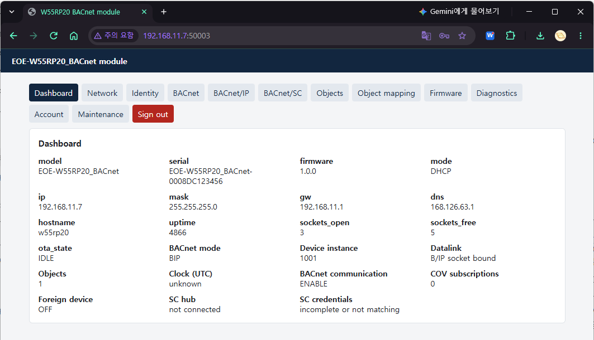
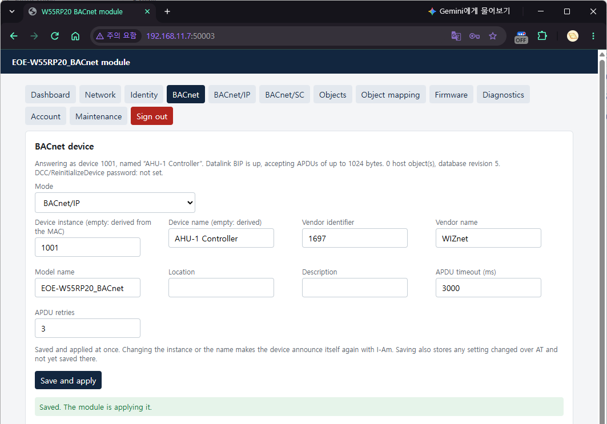
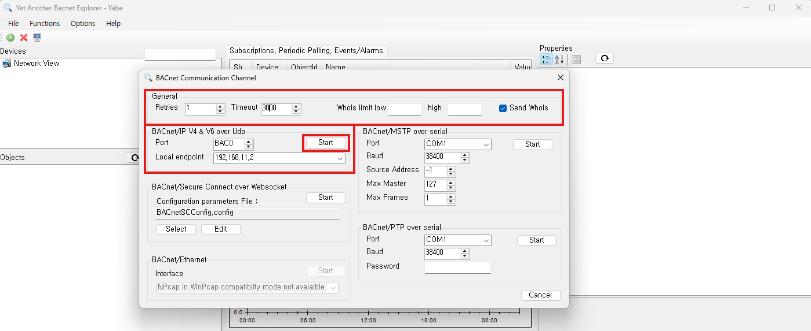
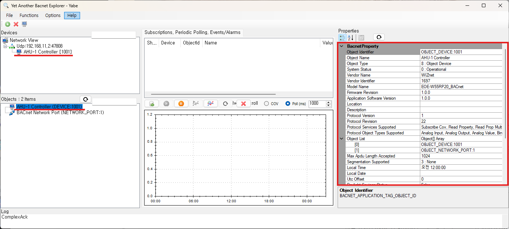
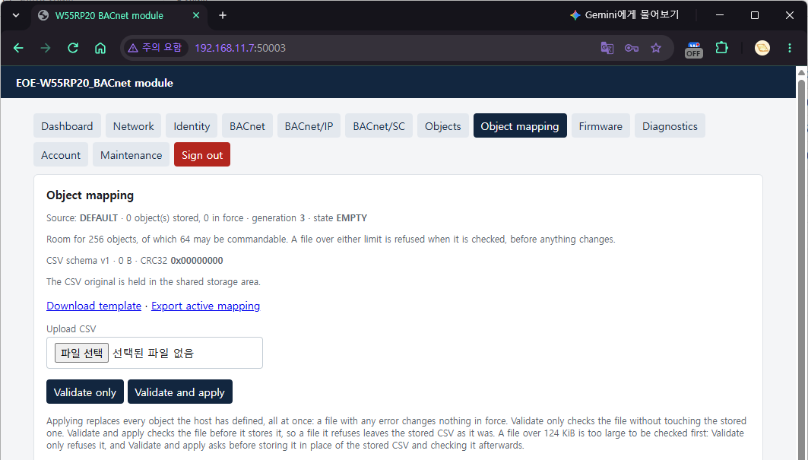
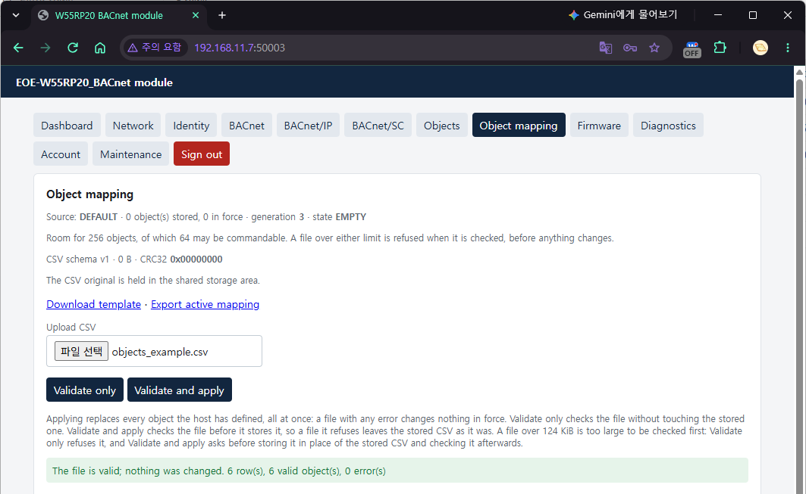
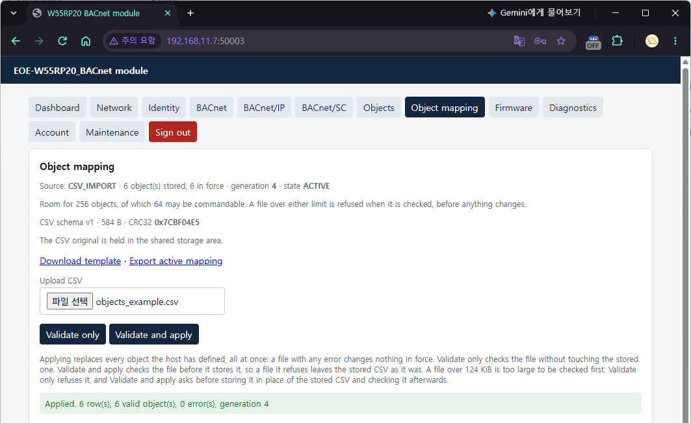
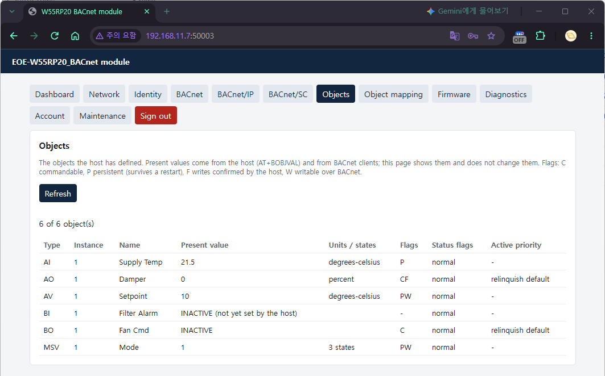
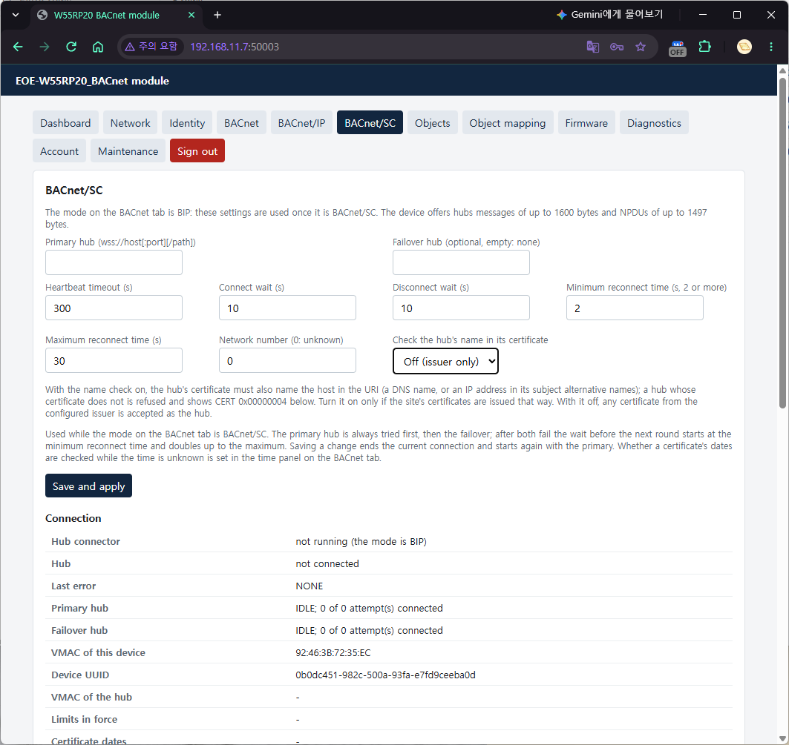

# EOE-W55RP20_BACnet Module BACnet Setup Guide

<p style={{textAlign: 'right'}}>Firmware 1.0.0</p>

This is the procedure for bringing an EOE-W55RP20_BACnet module in its factory state to the
point where it **communicates with a BACnet workstation**. The workstation examples use YABE
(Windows) and bacpypes3 (Python).

The module runs **either BACnet/IP (Annex J) or BACnet/SC (Annex AB)**. It does not use both
at the same time — using both at once would require the device to be a BACnet router, which is
outside the scope of this release. The factory default is **both off (`OFF`)**, and you first
choose which one to use in §0.5.

Object definitions, device identity, time, the hub and credentials are described **for both AT
commands and the Web GUI**. Either way gives the same result. The two use the same check
functions, so they also reject the same values.

> This document is written for firmware **1.0.0**. Check the version in the first
> field of `AT+VERSION?`. The full format of each command and every error code are in the
> [AT Command Guide](./at-command-guide-en.md). This document covers only the order of the first setup.

> **Vendor ID.** The module ships with **Vendor_Identifier 1697**, which ASHRAE assigned to WIZnet.
> An integrator that sells the module as its own product can change it to the number it received
> from ASHRAE, together with its company name and model name (§3.1). Do not borrow another company's number.

---

| Chapter | Contents |
|---|---|
| [0](#sec-0) | Before you start |
| [1](#sec-1) | Network |
| [2](#sec-2) | Turning on the Web GUI |
| [3](#sec-3) | BACnet/IP — making the module visible to a workstation |
| [4](#sec-4) | Object definitions — putting host values on BACnet |
| [5](#sec-5) | From another subnet — Foreign Device registration |
| [6](#sec-6) | Time — BACNET / SNTP / BOTH, UTC offset |
| [7](#sec-7) | BACnet/SC — over TLS through a hub |
| [8](#sec-8) | DCC / ReinitializeDevice password |
| [9](#sec-9) | Firmware update (OTA) |
| [10](#sec-10) | When you are stuck |
| [Appendix](#appendix-minimal) | A minimal set of settings |
| [Appendix](#appendix-limits) | Limits at a glance |

---

<a id="sec-0"></a>

## 0. Before you start

### State right after a factory reset

After `AT+FACTORY="CONFIRM"`, holding the factory reset pin for 5 seconds (FACT RSTn on the
EOE-W55RP20, the switch inside the case on the W232N; the WIZ-IP20 has none), or Factory reset on the
Web GUI Maintenance tab, the module is in this state.

| Item | Factory default | Notes |
|---|---|---|
| Network | **STATIC 192.168.11.2 / 255.255.255.0** | Gateway 192.168.11.1, DNS 8.8.8.8 |
| Host name | `w55rp20` | |
| **BACnet mode** | **`OFF`** | ← advertises nothing on the network (`AT+BACMODE?` → `OFF`) |
| Device instance | **Derived from the factory MAC** | Lower 22 bits of the MAC — differs from module to module |
| Device name | **`EOE-W55RP20_BACnet-XXXXXX`** | Model name + last 3 bytes of the MAC (hex) |
| Vendor_Identifier | **1697** (WIZnet) | Vendor_Name `WIZnet`, Model_Name `EOE-W55RP20_BACnet` |
| User objects | **None** | Only Device and Network Port exist |
| B/IP | UDP **47808**, subnet-directed broadcast | Foreign Device registration off |
| BACnet/SC | **No** hub, **no** credentials | Timers 300 / 10 / 10 / 2 / 30 s |
| Time source | **`BACNET`**, certificate policy **`LENIENT`** | No SNTP server, UTC offset 0 |
| DCC/RD password | **None** | ← anyone can silence or restart the device (§8) |
| **Web GUI** | **Off** | No password set |
| AT UART | 115200 8N1, **no flow control** | Can be changed with `AT+UART` |

A factory reset **erases the BACnet/SC credentials (including the private key) first.** This is so
that no key is left behind when the module is handed over or scrapped. Object definitions, the
stored CSV and PERSISTENT values are erased as well. Factory data (MAC, serial number) remains.
While a firmware image is waiting to be installed, a factory reset is refused (`ERROR:OTA_PENDING`,
and `+FACTORY:ERROR,OTA_PENDING` on the AT port). If the credential slots are not erased after two
attempts, **nothing is reset and the module does not reboot** —
`+FACTORY:ERROR,CREDENTIALS` (AT gives `ERROR:STORAGE_FAILURE`, the web `500`). This is so that the
reset does not look finished while the key remains. Try again; if it keeps happening, the flash is faulty.

Three things matter here.

> **The first setup must be done over AT.** The Web GUI is **off** in the factory default.
> This is so that the module is not shipped with an HTTP server with a known password on the
> network, and it is why turning the web on cannot itself be done over the web (§2).

> **BACnet is off.** A module in the factory state does not answer Who-Is. This is the same
> principle as the web being off — it sends nothing onto the network until it is turned on.

> **The address is STATIC 192.168.11.2.** If the PC is on a different subnet, the module is not visible.
> In step 1, switch to DHCP or put the PC on the same subnet.

### 0.5 BACnet/IP or BACnet/SC: which to use

Decide this first. The settings that follow depend on it.

| | BACnet/IP (`BIP`) | BACnet/SC (`SC`) |
|---|---|---|
| Transport | UDP 47808, plaintext | **WebSocket over TLS 1.3**, through a hub |
| How peers are found | Broadcast on the same subnet; other subnets through a BBMD (§5) | The hub relays — independent of subnets |
| What you need | The same IP subnet or a BBMD | Hub URI + private key + device certificate + issuer (CA) certificate |
| Authentication and encryption | None | Mutual certificate authentication (EC P-256), encryption |
| Max_APDU_Length_Accepted | **1024** | **1476** |
| Settings section | §3, §5 | §7 |
| Factory default | Off | Off |

- **If you are joining an existing BACnet/IP site, use B/IP.** On the same subnet as the
  workstation, you only need to set the mode and the instance.
- **If the site runs a BACnet/SC hub, or traffic has to cross the internet or another building, use SC.**
  You need the hub's address and certificates issued by the site's certificate authority.
- **Why the B/IP APDU is 1024.** The W5500 does not reassemble IP fragments. So a datagram with
  a UDP payload over 1472 B is lost when received, and when sent, the peer has to reassemble
  the fragments. 1024 is the largest of the standard steps (50/128/206/480/1024/1476) that fits
  within this limit. Workstations read this value and do not send larger requests. For the same
  reason, **broadcasts over 1472 B sent by other devices (for example a large Forwarded-NPDU
  wrapped by a BBMD) do not reach this module.** SC runs over TCP and does not have this limit.

```text
AT+BACMODE?          check the current setting
+BACMODE:OFF,STOPPED
```

### Saving and applying — how AT and the web differ

**AT setting commands change only the settings in RAM. The change appears on the network after `AT+SAVE`.**
Even if you change the instance with `AT+BACDEV`, the device answers with the old instance until
`AT+SAVE` — so that no client ever sees an identity that would disappear on a reset without saving.

**The web's "Save and apply" saves and applies on the spot.** It also **saves the settings changed
over AT and not yet saved** — because a save writes the whole configuration at once. If you are
trying something out over AT, tidy it up before saving on the web.

Exceptions to this rule:

- **Object commands are not settings.** `AT+BOBJADD`, `AT+BOBJDEL` and `AT+BOBJVAL` are visible
  on the network immediately. However, the object table changed with `AT+BOBJADD` and `AT+BOBJDEL`
  is kept in flash only at `AT+SAVE` (§4.2).
- BACnet/SC **credentials** are not settings, so they are written to flash as soon as they are uploaded or erased (§7).
- **Commands that replace the whole mapping save by themselves** — `AT+BMAPCLEAR`, `AT+BMAPRELOAD`, and
  **Validate and apply**, **Re-apply stored CSV** and **Clear mapping** on the web Object mapping tab (§4.3).

> **These self-saving commands also write the whole configuration.** As with the web's Save and apply,
> settings changed over AT and not yet saved go into flash with them. Of those, the BACnet settings
> (`AT+BACMODE`, `AT+BACDEV`, `AT+BIP`, `AT+BIPFD`, `AT+TIMESRC`, `AT+BACPASS` and so on) **are also
> applied right away**. Network settings (`AT+IP`, `AT+NETMODE` and so on) and web settings are only
> saved; they are applied at the next `AT+SAVE` or reboot. Before using a mapping command, commit the
> AT settings you were trying out with `AT+SAVE`, or revert them.

### What you need

- A serial port for the AT UART (115200 8N1) — Tera Term or similar
  - That is the factory default. A board someone else has used may have a different speed
- A PC on the same network, and one of these two BACnet workstations
  - **YABE** (Yet Another BACnet Explorer, Windows)
  - **bacpypes3** — `pip install bacpypes3` (Python 3.8 or later). The examples in this document
    were checked with 0.0.110
- If you use BACnet/SC: the hub's `wss://` address, and a private key, device certificate and issuer certificate (§7.1)

The examples in this document use **COM11 = AT, 192.168.11.160 = module, 192.168.11.50 = PC,
Device 1001 = module**; substitute your own values when reading them.

---

<a id="sec-1"></a>

## 1. Network

With DHCP:

```text
AT+NETMODE=DHCP
AT+SAVE
```

With a static address:

```text
AT+NETMODE=STATIC
AT+IP=192.168.11.160
AT+MASK=255.255.255.0
AT+GW=192.168.11.1
AT+DNS=192.168.11.1
AT+SAVE
```

**`AT+SAVE` saves and applies together.** When the network actually changes, **all open sockets are
closed** — if you were connected over the web or BACnet at that moment, the connection drops, and the
B/IP socket and the SC hub connection are reopened on the new address. An `AT+SAVE` that did not touch
the network (a save that changed only BACnet settings) does not close sockets.

Check the address:

```text
AT+IP?
+IP:"192.168.11.160"
```

> **DNS is used by BACnet/SC and Foreign Device registration.** If you give the hub URI, the BBMD or
> the SNTP server as a name, the module resolves that name with this DNS server. If you give an IP
> address, DNS is not used. With DHCP the module uses the DNS the DHCP server gave; if the server gives
> no DNS, it uses the DNS set here. Replies are accepted **only from that DNS server's address, port 53** —
> a server that answers from a different address (behind some NATs) does not resolve names, so give the
> address that answers as the DNS.

> **If you unplug and replug the cable under DHCP**, the module renegotiates at once. If it gets the same
> address, connections stay as they are; if it gets a different address, sockets are closed and
> `+IPCHANGED` reports the new address. If the server refuses the lease renewal (NAK), the module also
> renegotiates from the beginning.

### On the web — Network tab

Once the web is on (§2), the Network tab does the same thing. **Mode** is a `DHCP`/`STATIC` list;
choosing DHCP locks the IP, Subnet mask, Gateway and DNS fields (they hold the values the DHCP server
gave and are not saved). **Apply and save drops every connection when the settings actually changed** —
including this page's session.

---

<a id="sec-2"></a>

## 2. Turning on the Web GUI

Every step after this can also be done on the web. The web is off in the factory state, so **turn it on
over AT first:**

```text
AT+WEBUSER="admin"
AT+WEBPASS="your-password"
AT+WEB=1,600
AT+SAVE
```

The 600 in `AT+WEB=1,600` is the session idle time (seconds). The password must be **at least 8 characters**.

In a browser, go to **`http://<module-address>:50003/`** and sign in.

> **Do not leave out the port number.** The web UI is on **50003**, not 80. If you type only the
> address, the browser goes to 80 and gets no answer, which looks exactly as if the web UI were not turned on.

> **This page is HTTP.** This module does not have the memory to run TLS for the web (this is separate
> from the TLS of BACnet/SC). The password travels in plaintext, so use it on a network you trust.

> **The web server handles requests one at a time.** It takes one request being processed and one
> waiting connection, and refuses a third simultaneous connection (TCP RST — only one socket listens on
> the web port, to save hardware sockets). The web pages do not run into this limit. When you call the
> web API from a script, send requests one at a time, and retry a little later after a refused or reset
> connection. Details are in chapter 12 of the AT command guide.

> **When you call the web API directly:** JSON string escapes accept only `\"`, `\\` and `\/` (anything
> else makes the whole request `400`). Send text such as names and descriptions as plain UTF-8 — the web
> page's `JSON.stringify()` escapes only control characters and unpaired surrogates, so the page has no
> problem with this.

The tabs are as follows. This document mostly uses the five BACnet-related ones.

| Tab | What it does |
|---|---|
| Dashboard | BACnet mode, the instance it answers with, data link state, object count, clock, SC hub and credential state |
| Network · Identity | Addresses, AT port settings / product ID |
| **BACnet** | Mode, device identity, DCC/RD password, **time panel** |
| **BACnet/IP** | UDP port, broadcast method, Foreign Device registration |
| **BACnet/SC** | Hub URI, timers, connection state, **credentials panel** |
| Objects | Object table (view only) |
| **Object mapping** | Upload, check, export and clear the object definition CSV |
| Firmware | OTA upload |
| Diagnostics · Account · Maintenance | Diagnostics / web account / reboot and factory reset |



Only **one session** can be open at a time. When you are done, press **Sign out** at the end of the tab
row — closing the tab is not signing out, and the session remains for the idle time. Even so, no one else
is locked out: **signing in with the correct password takes over the remaining session.** From then on,
requests from the browser that was open first are refused with 401, and that page returns to the sign-in
form, which states the reason. If you signed in from another tab of the same browser, the tab opened first
shares the cookie, so reading keeps working, and it returns to the sign-in form the first time it tries to
save. The session also ends, and the page shows the same form, when the network settings change (`AT+SAVE`
on the AT port, a DHCP lease change) and when the idle time runs out.

A save in progress at the moment the network settings change **may be cut off without an answer.** The
page then shows "No reply: … the request may still have been carried out", and a little later, if the
session is still alive, reloads that tab — the change may already have gone in, so check the tab's values
before doing it again. If a firmware upload is cut off that way, the page asks the module again a little
later. If the module answers, that file will not be installed, so the page shows a refusal (if an update
received earlier is waiting for a restart, it says that too); if there is no answer — the module may be
restarting to install the file it received — the message stays as it is.

---

<a id="sec-3"></a>

## 3. BACnet/IP — making the module visible to a workstation

### 3.1 Method A — AT commands

```text
AT+BACMODE=BIP
AT+BACDEV=1001,"AHU-1 Controller"
AT+BACVENDOR=1697,"WIZnet","EOE-W55RP20_BACnet"
AT+SAVE
```

The `AT+BACVENDOR` line is the factory default and can be left out. **If you sell the module as your own
product, put your own Vendor ID, company name and model name here** — the three values are a single
statement, so always write them together (a Vendor_Identifier with another company's Vendor_Name is worse
than both being the defaults).

The difference before and after saving:

```text
AT+BACDEV=1001,"AHU-1 Controller"
OK
AT+BACDEV?
+BACDEV:1001,"AHU-1 Controller"
+BACDEV:APPLIED,1193046,"EOE-W55RP20_BACnet-123456"     ← the identity it answers with now
OK
AT+SAVE
OK
AT+BACDEV?
+BACDEV:1001,"AHU-1 Controller"                       ← one line once the two match
OK
```

The `APPLIED` line appears **only when the setting and the actual state differ**. The `OK` of `AT+SAVE`
means the save is finished; the new identity is **applied by the BACnet task after that** (tens of ms).
So an `AT+BACDEV?` sent right after the `OK` may still show the `APPLIED` line — ask again a little later,
and if it is still there, `AT+SAVE` was not done. If a host program confirms the save with this line, do
not decide from a single look right after `AT+SAVE`; ask again after a short interval. When the instance
or the name changes, the device **broadcasts I-Am again**.

| Argument | Value |
|---|---|
| Instance | `0` to `4194302`. `4194303` is the wildcard every device answers, so it is refused (`ERROR:VALUE_OUT_OF_RANGE`) |
| | `DEFAULT` — returns to the value derived from the MAC |
| Name | Up to 31 bytes (UTF-8). `""` means "the derived name"; **omitting it keeps the current name** |
| | If an object with the same name exists, `ERROR:DUPLICATE_NAME` (Object_Name is unique within the device) |

```text
AT+BACDEV=DEFAULT          only the instance back to the derived value, name unchanged
AT+BACDEV=1001,""          only the name back to the derived value
```

Check:

```text
AT+BACMODE?
+BACMODE:BIP,RUNNING
AT+BIP?
+BIP:47808,SUBNET,192.168.11.160,192.168.11.255
```

The second field of `+BACMODE:` is **whether the data link is actually running**. Between `AT+BACMODE=`
and `AT+SAVE`, and for the tens of ms right after the save while the BACnet task applies it, the setting
(first field) and the state may differ — `OFF,RUNNING` means "told to turn off and still turning off".
The last two fields of `+BIP:` are the address of the socket open now and the actual broadcast address;
with no socket they are `0.0.0.0`.

To change the UDP port and the broadcast method:

```text
AT+BIP=47808,SUBNET        subnet-directed broadcast (default, recommended)
AT+BIP=47808,GLOBAL        255.255.255.255
AT+SAVE
```

If you leave out the broadcast method, the current value is kept. **A UDP port equal to the web port
(50003) is refused** (`ERROR:INVALID_PARAMETER`) — the W5500 uses one port space for TCP and UDP, so
whichever opens later fails.

For the same reason, if an `AT+SOCKOPEN` channel holds the B/IP port as its local port, the B/IP socket
does not open (`+BACMODE:BIP,STOPPED`). The module **retries this by itself** — after 5 seconds, then at
intervals that double each time up to 60 seconds, until the port is released and the socket opens.
Meanwhile the socket field of `+DIAG:BIP` is `RETRY` and the last field is the errno of the failure
(`112` for a port conflict) (§10).

### 3.2 Method B — Web GUI

This is the form at the top of the **BACnet** tab.

| Field | Type | Value to enter |
|---|---|---|
| Mode | **List** | `Off` · `BACnet/IP` · `BACnet/SC` |
| Device instance | Input | `1001`. **If left empty, it is derived from the MAC** — the derived value is shown as a grey hint |
| Device name | Input | `AHU-1 Controller`. If left empty, it is derived |
| Vendor identifier / Vendor name / Model name | Input | Defaults `1697` · `WIZnet` · `EOE-W55RP20_BACnet`. Your own values for your own product. **At 0 the page shows a warning** |
| Location · Description | Input | The Device's Location and Description (up to 63 bytes) |
| APDU timeout (ms) · APDU retries | Input | Default 3000 / 3 — used for the confirmed COV notifications the device sends |

Pressing **Save and apply** saves and applies at once. A line above the form states **the identity it is
answering with now**, as "Answering as device …", and if that differs from the settings, it states the
difference too.



> **Over AT**, set Location and Description with `AT+BACDEVINFO="<location>","<description>"`, the APDU
> timeout and retries with `AT+BACAPDU=<ms>,<retries>`, and the Network number of B/IP and SC (below) with
> `AT+BACNETNUM=<BIP|SC>,<number>`. Like the other BACnet settings, they are applied at `AT+SAVE`.

The port and broadcast are on the **BACnet/IP** tab.

| Field | Type | Value to enter |
|---|---|---|
| UDP port | Input | `47808` |
| Local broadcast | **List** | `Subnet (directed broadcast)` · `Global (255.255.255.255)` |
| Network number | Input | `0` (unknown). Only shown in the Network Port object (AT: `AT+BACNETNUM=BIP,<number>`) |

A line above the tab states the socket open now, such as "Socket open on 192.168.11.160, UDP port 47808.
Local broadcasts go to 192.168.11.255."

### 3.3 Checking — bacpypes3

Start the bacpypes3 console on the PC. **The PC side must also use UDP 47808** — the module's broadcast
I-Am goes to 47808, so a client listening on another port does not hear the answer to a broadcast
Who-Is. `--instance` is any number that does not clash with the module.

```text
$ python -m bacpypes3 --address 192.168.11.50/24 --instance 999001
> whois
1001 192.168.11.160
> whois 192.168.11.160
1001 192.168.11.160
> read 192.168.11.160 device:1001 object-name
AHU-1 Controller
> read 192.168.11.160 device:1001 object-list
[(<ObjectType: device>, 1001), (<ObjectType: network-port>, 1)]
> read 192.168.11.160 device:1001 max-apdu-length-accepted
1024
```

Giving an address, as in `whois 192.168.11.160`, sends a **unicast** Who-Is, and the module also answers
with a unicast I-Am — on a network where broadcasts are blocked, this is the reliable way.

### 3.4 Checking — YABE

This is for YABE 2.1.0.

1. Start YABE and choose **Functions → Add BACnet Channel** (the same as the **Add Channel** button on
   the toolbar). The **BACnet Communication Channel** window opens.
2. In the **General** box at the top of the window, change **Timeout** to `3000` (default 500). Leave
   Retries at `1` and **Send WhoIs** checked.
3. In the **BACnet/IP V4 & V6 over Udp** box, leave Port at `BAC0` (hex, = 47808), and for **Local
   endpoint choose the PC address on the same subnet as the module** (192.168.11.50).
4. Press **that box's Start** (to the right of the Port line). The window has five Start buttons (BACnet/IP ·
   SC · MSTP · PTP · Ethernet) — pressing the Start of another box opens a different kind of channel.
5. A Udp channel appears under `Network View` in the **Devices** tree at the top left, and Device
   **1001** appears under it. Click it and the **Objects** pane at the bottom left shows the Device object
   and the Network Port object; click an object and its properties appear in the **Properties** pane on the right.
   The Device and Network Port objects are read-only: they are configured over AT or the web (§3.5).





> **Why raise Timeout to 3000.** YABE's default of 500 ms is shorter than the 750 ms the module waits for
> the host's approval on a confirmed write (§4.5). Left as it is, YABE times out before the module
> answers. Changing `DefaultTimeout` in **Options → Settings** to 3000 makes it the initial value of this window.

> If only a COM port name such as `COM3` appears in the tree and the log shows `Mstp source address must be set up before
> sending messages`, you pressed the Start of the MSTP box. Right-click that channel →
> **Remove Channel/Device** to remove it, and start again from step 1.

> **Do not run YABE and bacpypes3 on 47808 on the same PC at the same time.** Only one program can open
> a UDP port, so the one started later receives nothing. Close one and use the other.

### 3.5 What the device answers

Device and Network Port can be read even before there are user objects. If you confirm the communication
itself before defining objects, you halve the possible causes when a problem comes up later.

| Object | Main properties |
|---|---|
| Device 1001 | Object_Name, Vendor_Identifier(1697), Vendor_Name, Model_Name, Firmware_Revision(`1.0.0`), Protocol_Revision **22**, Max_APDU_Length_Accepted(B/IP 1024 · SC 1476), Segmentation_Supported **no-segmentation**, Object_List, Database_Revision, Local_Time·Local_Date·UTC_Offset(§6), Last_Restart_Reason |
| Network Port 1 | Object_Name `BACnet Network Port`, BACnet_IP_Mode(normal/foreign), IP addresses, BACnet_IP_UDP_Port, FD_BBMD_Address — **read-only** (set over AT and the web) |

Services a workstation can use: ReadProperty, ReadPropertyMultiple, WriteProperty,
WritePropertyMultiple, Who-Is/I-Am, Who-Has/I-Have, SubscribeCOV (16 subscriptions, confirmed and
unconfirmed notifications), DeviceCommunicationControl and ReinitializeDevice (§8),
TimeSynchronization and UTCTimeSynchronization (§6). Segmentation is not done — if a response does not
fit the peer's max-APDU, the module answers with Abort (segmentation-not-supported).

---

<a id="sec-4"></a>

## 4. Object definitions — putting host values on BACnet

### 4.1 Rules

The host MCU can define nine kinds of objects.

| Short name | Name | Type number | Fourth argument (AT) | Notes |
|---|---|---|---|---|
| AI · AO · AV | analog-input · -output · -value | 0 · 1 · 2 | **units** (required) | `62` or `degrees-celsius` |
| BI · BO · BV | binary-input · -output · -value | 3 · 4 · 5 | None | |
| MSI · MSO · MSV | multi-state-input · -output · -value | 13 · 14 · 19 | **number of states** (required, 2 to 16) | |

The type can be written as the short name, the name or the number (`AI` = `analog-input` = `0`). AT
and CSV read it with the same function.

**Flags** — the fifth argument (AT); in CSV, each flag has its own column.

| Flag | Meaning | Constraint |
|---|---|---|
| `C` commandable | Has a priority array (1 to 16) | **AO, BO and MSO are always C**. Cannot be given to an Input |
| `P` persistent | Present_Value survives a reboot — but flash writes are limited to one per object per 10 seconds (§4.4 "PERSISTENT values and power loss") | Only objects that are not commandable |
| `F` confirmed | A remote write is committed **only after the host approves it** (§4.5) | |
| `W` writable | The Present_Value of a Value object can be written remotely | A commandable Value object is W automatically |

- **The Present_Value of an Input object belongs to the host.** A remote write is accepted only while
  Out_Of_Service is TRUE.
- **The Present_Value of a commandable object is set by the priority array.** If the host puts a value
  with `AT+BOBJVAL`, the answer is `ERROR:ACCESS_DENIED` (the states `FAULT`/`OK` can be put — §4.4). The
  priority array **does not survive a reboot** — after a restart the object starts from Relinquish_Default.
- There can be **up to 256 objects**, of which **up to 64 commandable**. Names are up to **31 bytes** and
  must be unique within the device (including the names of Device and Network Port).

### 4.2 Method A — AT commands

```text
AT+BOBJADD=AI,1,"Supply Temp",degrees-celsius,P
AT+BOBJADD=AV,1,"Setpoint",degrees-celsius,W
AT+BOBJADD=AO,1,"Damper",percent,F
AT+BOBJADD=BO,1,"Fan Cmd"
AT+BOBJADD=BV,2,"Pump Enable",,WF
AT+BOBJADD=MSV,1,"Mode",3,W
AT+SAVE
```

Arguments:

```text
AT+BOBJADD=<type>,<instance>,"<name>"[,<units|number of states>[,<flags>]]
```

**Positions are not guessed from the number of arguments.** A binary object has no fourth argument, but
to give flags, keep the comma (`AT+BOBJADD=BV,2,"Pump Enable",,WF`).

> **If you leave out `AT+SAVE`, objects created with `AT+BOBJADD` disappear at the next reboot.**
> `AT+BOBJADD` and `AT+BOBJDEL` change only the running object table; they are folded into the stored
> mapping at `AT+SAVE`. An object is visible on the network as soon as it is created (Database_Revision goes up by 1).

The other properties of an object created over AT are defaults — no write range limit, COV_Increment 0,
Relinquish_Default 0.0 / INACTIVE / 1, no Description, Polarity NORMAL. To set them, use CSV
(§4.3).

Check:

```text
AT+BOBJ?
+BOBJ:AI,1,"Supply Temp",P,0
+BOBJ:AO,1,"Damper",CF,0
+BOBJ:AV,1,"Setpoint",W,0
+BOBJ:BO,1,"Fan Cmd",C,INACTIVE
+BOBJ:BV,2,"Pump Enable",FW,INACTIVE
+BOBJ:MSV,1,"Mode",W,1
OK
```

The list is in object identifier order. AO 1 was given only `F` but shows as `CF` — AO is always commandable.

What is refused:

```text
AT+BOBJADD=AI,1,"Dup",62
ERROR:INSTANCE_IN_USE            ← the same type and instance already exists

AT+BOBJADD=AI,2,"Supply Temp",62
ERROR:DUPLICATE_NAME             ← names are unique within the device

AT+BOBJADD=AI,3,"NoUnits"
ERROR:INVALID_PARAMETER          ← an analog object without units

AT+BOBJADD=BI,3,"Bad",62
ERROR:INVALID_PARAMETER          ← a fourth argument on a binary object: refused, not ignored

AT+BOBJADD=AI,4,"BadUnit",furlongs
ERROR:INVALID_PARAMETER          ← unknown units name

AT+BOBJADD=MSI,5,"OneState",1
ERROR:VALUE_OUT_OF_RANGE         ← the number of states is 2 to 16

AT+BOBJADD=AI,6,"CmdInput",62,C
ERROR:INVALID_PARAMETER          ← an Input cannot be commandable

AT+BOBJADD=XX,1,"x"
ERROR:TYPE_MISMATCH              ← not one of the nine types
```

With 256 objects the answer is `ERROR:OBJECT_LIMIT`; with 64 commandable objects, `ERROR:COMMAND_SLOTS`.

Deleting:

```text
AT+BOBJDEL=AI,1
AT+SAVE
```

An object that does not exist gives `ERROR:OBJECT_NOT_FOUND`.

The header of the stored mapping is shown with `AT+BMAP?`:

```text
AT+BMAP?
+BMAP:MANUAL_AT,6,1,0,0x00000000,<generation>
```

The fields are the source (`DEFAULT`, `MANUAL_AT`, `CSV_IMPORT`, `CSV_IMPORT_MODIFIED`), the object count,
the CSV schema version, the size of the original CSV, its CRC, and the generation number. It reports
**what is stored**, so after `AT+BOBJADD` and before `AT+SAVE` it shows the old count — the running table
is `AT+BOBJ?`. The generation number changes every time the stored mapping changes, so you can tell a
different mapping even when the count is the same. If you edit over AT a table uploaded as CSV and save it,
the source becomes `CSV_IMPORT_MODIFIED` (the size and CRC of the original CSV remain, for tracking the source).

### 4.3 Method B — Web GUI (CSV upload)

On the web you do not create objects one at a time; you **upload them all at once as a CSV.** The Objects
tab is view only; editing is on the **Object mapping** tab.

**1) Get the template** — *Download template* gives a single header line. If objects have already been
uploaded, it is safer to get the current ones with *Export active mapping* and edit that.



**2) Write the CSV** — one object per line; the column order is free.

```csv
object_type,instance,name,description,units,number_of_states,min,max,cov_increment,relinquish_default,commandable,writable,persistence,write_mode,polarity
AI,1,Supply Temp,Supply air temperature,degrees-celsius,,-40,120,0.5,,,,PERSISTENT,,
AV,1,Setpoint,Supply air setpoint,degrees-celsius,,10,35,0.5,,N,Y,PERSISTENT,IMMEDIATE,
AO,1,Damper,Outside air damper,percent,,0,100,1,0,Y,,,CONFIRMED,
BI,1,Filter Alarm,Filter differential pressure,,,,,,,,,,,NORMAL
BO,1,Fan Cmd,Supply fan start/stop,,,,,,INACTIVE,Y,,,IMMEDIATE,NORMAL
MSV,1,Mode,Occupancy mode,,3,,,,,N,Y,PERSISTENT,,
```

| Column | Required | Example | Rule |
|---|---|---|---|
| `object_type` | ● | `AI`, `analog-input`, `0` | The nine types |
| `instance` | ● | `1` | 0 to 4194302, unique together with the type |
| `name` | ● | `Supply Temp` | Up to 31 bytes, no control characters, unique within the device |
| `description` | | | Up to 31 bytes, no control characters |
| `units` | Analog | `62`, `degrees-celsius` | A number or a BACnet units name |
| `number_of_states` | Multi-state | `3` | 2 to 16 |
| `min` / `max` | | `-40` / `120` | Analog only. The allowed range — checked for writes from workstations and for the host's `AT+BOBJVAL` alike. Empty means no limit |
| `cov_increment` | | `0.5` | Analog only, 0 or more |
| `relinquish_default` | Commandable | `0`, `INACTIVE`, `1` | Within the type's range |
| `commandable` | | `Y` / `N` | Always Y for AO, BO and MSO; N for Inputs |
| `writable` | | `Y` / `N` | Value objects (AV, BV, MSV) |
| `persistence` | | `VOLATILE` / `PERSISTENT` | PERSISTENT only for objects that are not commandable |
| `write_mode` | | `IMMEDIATE` / `CONFIRMED` | CONFIRMED: the host approves every write (§4.5) |
| `polarity` | | `NORMAL` / `REVERSE` | BI and BO |

> **The only columns the header must contain are `object_type`, `instance` and `name`.** But as the
> "Required" column of the table says, **depending on the type, three more fields cannot be left empty
> in a row** — `units` for analog objects, `number_of_states` for multi-state objects, and
> `relinquish_default` for commandable objects (always for AO, BO and MSO). If such a field is empty (or
> the column is missing altogether), that row fails with "required field is empty", and so the whole file
> is refused. `AT+BOBJADD` fills in `relinquish_default` as 0, INACTIVE or 1, but CSV does not. Other
> fields take their default values when missing or empty. A row is up to 511 bytes.

**Quotes** — a field containing a comma or a line break is enclosed whole in double quotes, and a `"`
inside it is written as `""` (the way spreadsheets save, read the same way as Python `csv`). A double
quote opens a field **only when it is the field's first character** (spaces and tabs after the comma are
skipped). A `"` anywhere else is an ordinary character, so a description such as `12" pipe` is read as
written. Line ends can be CRLF or LF, but a CR that is not at a line end stays in the field as a character
and is refused as a control character. **Control characters** are C0 (including tab and line feed), DEL
and C1 (U+0080 to U+009F, for example NEL) — the same rule as `AT+BOBJADD`.

**3) Validate only** — press this first. **Nothing changes** — the file being checked goes to a separate
scratch area, and both the running objects and the stored CSV stay as they are.

A good file is answered with "The file is valid; nothing was changed. 6 row(s), 6 valid object(s), 0
error(s)". A bad file gets the reason for each row:



```text
Row 3, Column instance: instance is not a number 0..4194302
Row 4, Column units: unknown engineering units
Row 5, Column commandable: commandable must be Y or N, and an input cannot be commandable
Row 6, Column name: duplicated name
```

**Row numbers count the header as row 1, so the first data line is row 2.** Up to 32 errors are listed. An
empty line takes a row number, but is not counted in the "N row(s)" of the result. An error beyond row 65,535 is reported as `Row 65535 or later` (this happens
only with a large file stored without checking).

**If even one row is wrong, nothing is applied** — there is no partial apply. A file with more than 256
objects, or more than 64 commandable objects, is also refused **at the check stage** (you never find out
only after applying).

**4) Validate and apply** — press it after the check passes. Confirm the prompt "Replace every object with the contents
of &lt;file&gt;?", and the mapping changes at once and the original CSV is stored.





> **A new object starts with a start value until the host sets one.** Right after a CSV is applied or
> an object is created with `AT+BOBJADD`, the value is `0` for an analog object (or the nearer bound if
> its range does not include 0 — AV 1 in the example starts at `10`), `INACTIVE` for a binary object
> and `1` for a multi-state object. A commandable object (AO 1, BO 1) reads its `relinquish_default`.
> The web Objects tab marks input objects "(not yet set by the host)". The value changes when the host
> sets it with `AT+BOBJVAL` (§4.4) — the CSV has no column for the present value.

> **Applying a CSV replaces all existing objects.** It does not add only some — objects created over AT
> disappear too. This is why you *Export* the current ones first.

> **Validate and apply checks the file before storing it.** A file this button refuses does not touch the
> stored CSV, so a later *Re-apply* applies the previous file as before. However, **a file over 124 KiB**
> has no room to be checked in advance. Validate only refuses such a file with `Too Large To Check` (413),
> and Validate and apply **asks first** — it sends the file only if you confirm "Store it in place of the
> stored CSV and then check it?". If a file sent that way is **refused**, that file takes the place of the
> stored CSV, so Re-apply is refused too (`AT+BMAPRELOAD` gives `INVALID_CSV`, and the page shows that
> warning); **if the transfer is cut off or the flash write fails**, no stored CSV remains at all
> (`CSV_NOT_AVAILABLE`). The objects in use change only if that file is valid. A host that uploads directly
> through the web API chooses this behaviour only with `POST /api/mapping/upload?unchecked=1` — an install
> over 124 KiB without that mark gets `413 Too Large To Check`, and the stored CSV stays as it is.

The result of applying is also visible over AT:

```text
AT+BMAP?
+BMAP:CSV_IMPORT,6,1,<size>,0x<CRC>,<generation>
```

#### Re-applying the stored CSV · clearing everything

| What it does | AT | Web (Object mapping tab) |
|---|---|---|
| Re-apply the stored CSV (undoes changes made over AT) | `AT+BMAPRELOAD` | **Re-apply stored CSV** |
| Delete all user objects (the stored CSV remains) | `AT+BMAPCLEAR="CONFIRM"` | **Clear mapping** |

```text
AT+BMAPCLEAR="CONFIRM"
OK
```

`CONFIRM` is case-sensitive; any other word gives `ERROR:INVALID_PARAMETER`. Clearing is **saved on the
spot** — a clear that waited for a save would let the table come back at the next boot, and it would not
be a "clear". PERSISTENT values are erased with it.

> **`AT+BMAPCLEAR`, `AT+BMAPRELOAD` and the web's three buttons (Validate and apply, Re-apply, Clear
> mapping) save the whole configuration.** Settings changed over AT without `AT+SAVE` go into flash with
> them, and BACnet settings are applied at once (§0 "Saving and applying"). If you have AT settings under
> trial, tidy them up first.

If there is no stored CSV, `AT+BMAPRELOAD` gives `ERROR:CSV_NOT_AVAILABLE`; if the file has errors,
`ERROR:INVALID_CSV`. While a web CSV upload is using the storage area, the answer
is `ERROR:STORAGE_BUSY` (the web Re-apply gives 409 "Storage Busy" — the page says "The storage area is in
use…"), and conversely an upload or download started while a re-apply is reading the CSV gets the same
answer. Try again after it finishes. **A firmware update erases the stored CSV** (§9) — from the moment the
download starts, a re-apply gets `ERROR:CSV_NOT_AVAILABLE` (the web gives 409 "No Stored CSV"); the objects
remain and Export works, but Re-apply is no longer possible.

### 4.4 The host puts values in

```text
AT+BOBJVAL=AI,1,21.5               analog: real number
AT+BOBJVAL=BV,2,ACTIVE             binary: ACTIVE / INACTIVE / 1 / 0
AT+BOBJVAL=MSV,1,2                 multi-state: 1..number of states
AT+BOBJVAL=AI,1,,FAULT             state only, no value: Reliability = UNRELIABLE_OTHER
AT+BOBJVAL=AI,1,21.5,OK            clear the state together with a value
```

`FAULT` sets the FAULT bit of Status_Flags, and `OK` clears it. The state-only form is used to report a
fault on a commandable object — its value comes from the priority array, so the host cannot put it, but
the host knows whether there is a fault.

```text
AT+BOBJVAL=BO,1,ACTIVE
ERROR:ACCESS_DENIED              ← commandable object: the value is set by the priority array

AT+BOBJVAL=MSV,1,4
ERROR:VALUE_OUT_OF_RANGE         ← exceeds the number of states (3)

AT+BOBJVAL=AI,1,150
ERROR:VALUE_OUT_OF_RANGE         ← outside min/max (-40 to 120). The value does not change

AT+BOBJVAL=AV,1,abc
ERROR:INVALID_PARAMETER

AT+BOBJVAL=AI,9,1
ERROR:OBJECT_NOT_FOUND
```

For an object whose Out_Of_Service the network has set to TRUE, every type gives `ERROR:ACCESS_DENIED` —
the value during that time is the one the workstation puts in to test. When Out_Of_Service is cleared, an
Input returns to the last host value before it.

**When a remote write arrives at an IMMEDIATE object**, the module commits it at once and only notifies the host:

```text
+BACWRITE:AV,1,0,22.5            <type>,<instance>,<priority>,<value>
+BACWRITE:BO,1,10,ACTIVE         commandable object: the priority written
```

The priority is 0 if the object is not commandable. A write of the same value again sends no
notification. If notifications pile up faster than the UART can carry them, they are merged and sent once
as "the value in effect now" (the deferred and coalesced counts of `+DIAG:BACNOTIFY` are those numbers).

**PERSISTENT values and power loss.** The value of a PERSISTENT object is kept in the runtime journal
(flash), but to avoid wearing the journal out, only **one record per object per 10 seconds** is written.
This is the same for `AT+BOBJVAL` and for a workstation's WriteProperty.

- A value that changes for the first time since the last 10-second tick is written at once.
- A value that changes again within the same 10 seconds stays in RAM, and only the last value is written at the next tick.
- So **even a value that got an `OK` or a SimpleACK may be missing from flash for up to about 10 seconds.**
  If power is cut, or a reset pin or watchdog reset comes, during that time, the object comes back after
  the reboot with the last recorded value. If you send `AT+BOBJVAL=AV,1,272` right after
  `AT+BOBJVAL=AV,1,271` and power is cut within a few seconds, the value after the reboot is `271`, even
  though both got `OK`. Values are never mixed or corrupted.
- `AT+SAVE`, `AT+REBOOT`, `AT+OTAREBOOT`, a reboot or post-update restart from the web, and ReinitializeDevice
  write all held values before restarting. A power cut gives no chance to do so.
- If the host knows power is about to be cut, it **waits at least 10 seconds after the last write, or sends
  `AT+SAVE`** (`AT+SAVE` also rewrites the configuration, so do not call it for every value).

The **Objects** tab of the Web GUI shows the same table — type, instance, name, Present value,
Units/states, Flags, Status flags, Active priority. The values belong to the host and the BACnet clients,
so **they are not written from this tab.**

### 4.5 CONFIRMED objects — `+BACWRITE` and `AT+BWRACK`

An object with flag `F` (`write_mode=CONFIRMED` in CSV) commits a remote write **only after the host
approves it**. Use it for values that cause real action, such as relays or valves.

Sequence:

1. The workstation sends WriteProperty
2. The module asks over AT: `+BACWRITE:<tid>,<type>,<instance>,<priority>,<value>` — **the tid comes first**
3. The host answers: `AT+BWRACK=<tid>,OK` (approve) or `AT+BWRACK=<tid>,<error>` (reject)
4. The module sends a SimpleACK or an Error to the workstation
5. **If there is no answer within 750 ms**, an Error (DEVICE, OPERATIONAL_PROBLEM) goes to the workstation,
   and a late answer gets `ERROR:HOST_TIMEOUT` (for the most recently expired write — see below)

```text
(workstation) write 192.168.11.160 analog-output:1 present-value 40 8
+BACWRITE:1,AO,1,8,40
AT+BWRACK=1,OK
OK
(workstation) SimpleACK — measured about 30 to 45 ms

(workstation) write 192.168.11.160 analog-output:1 present-value 90 8
+BACWRITE:2,AO,1,8,90
AT+BWRACK=2,VALUE_OUT_OF_RANGE   ← the host refuses (e.g. the equipment opens only to 80%)
OK
(workstation) Error: property / value-out-of-range

(workstation) write 192.168.11.160 analog-output:1 present-value null 8
+BACWRITE:3,AO,1,8,NULL          ← priority 8 released (relinquish)
AT+BWRACK=3,OK
```

> **A value outside the range is not sent to the host.** When an object has `min` and `max` (AO 1 in the
> §4.3 CSV is 0 to 100) and a value outside that range arrives, the module refuses it at once with
> Error (property / value-out-of-range), and no `+BACWRITE` is sent. The host's refusal is for a value
> that is inside the range but that the equipment cannot accept.

There are three words for a rejection, and they reach the workstation with error class PROPERTY.

| Second argument of `AT+BWRACK` | What the workstation receives |
|---|---|
| `OK` | SimpleACK, value committed |
| `WRITE_ACCESS_DENIED` | Error property / write-access-denied |
| `VALUE_OUT_OF_RANGE` | Error property / value-out-of-range |
| `INVALID_DATA_TYPE` | Error property / invalid-data-type |

**Any other word is refused, not taken as a rejection** (`ERROR:INVALID_PARAMETER`) — a typo of `OK` must
not reject a write the host meant to approve.

```text
AT+BWRACK=4,OK                   (after 750 ms have passed)
ERROR:HOST_TIMEOUT               ← too late. The workstation has already received an Error

AT+BWRACK=77,OK
ERROR:OBJECT_NOT_FOUND           ← no write is waiting with that tid (already answered, or a number never issued)

AT+BWRACK=0,OK
ERROR:VALUE_OUT_OF_RANGE         ← the tid is 1 to 65535
```

- **The module does not stop while waiting for the answer.** A pending write is kept separately, and
  other requests are handled as usual in the meantime. Up to **4** writes can wait at the same time; a
  fifth gets an Error (RESOURCES, NO_SPACE_TO_WRITE_PROPERTY) at once.
- `HOST_TIMEOUT` means "answer faster", and `OBJECT_NOT_FOUND` means "you are answering the wrong thing".
  That is why the two are not merged into one error.
- The module remembers only **the most recently expired write** for `HOST_TIMEOUT`, however. A late
  answer to a write that expired before that one gets `OBJECT_NOT_FOUND`. If several writes ran late
  together, an `OBJECT_NOT_FOUND` can also mean a timeout.
- A WritePropertyMultiple that includes a CONFIRMED object is refused (to prevent only part of it being committed).
- A write to an object that is Out_Of_Service is not passed to the host — the purpose of Out_Of_Service is
  to try commands without moving the equipment.
- Priority 6 is reserved for Minimum On/Off, so writes to it are refused (write-access-denied).

In the Web GUI you only **define** CONFIRMED (the `write_mode` of the CSV). Approval is the host MCU's
job, so it is done only over AT.

---

<a id="sec-5"></a>

## 5. From another subnet — Foreign Device registration

If the workstation is on another IP subnet and the module's subnet has no BBMD, register the module with a
remote BBMD as a **Foreign Device**. While it is registered, every broadcast the module sends (I-Am and
others) is also passed to the BBMD as Distribute-Broadcast-To-Network and spreads to the other subnets.
This is used only in B/IP mode. (This module does not itself become a BBMD.)

### 5.1 Method A — AT commands

```text
AT+BIPFD="192.168.20.1",47808,300
AT+SAVE
+BIPFD:REGISTERED,300
```

```text
AT+BIPFD="<BBMD address or name>",<BBMD UDP port>,<TTL seconds>
AT+BIPFD=0                                        stop registration
```

Registration starts after the Ethernet link comes up (about 2 seconds at boot). While it waits for the
link, `AT+BIPFD?` shows `OFF`, and this is not counted as a failure.

The three values are written together. The BBMD is an IPv4 address or a host name (up to 63 characters),
and a name is resolved with DNS (§1). The TTL is 1 to 65535 seconds, and the module re-registers **every half TTL**.

Check:

```text
AT+BIPFD?
+BIPFD:STATE,REGISTERED,300
+BIPFD:CONFIG,1,"192.168.20.1",47808,300
OK
```

The first line is the current registration state and the seconds left until the BBMD deletes the entry;
the second line is the configuration. The lines start with `STATE` and `CONFIG` so that they are not
confused with the `+BIPFD:REGISTERED,<ttl>` URC.

On failure, the URC and the query state the reason:

| URC | Meaning | What to check |
|---|---|---|
| `+BIPFD:FAILED,TIMEOUT` | The BBMD does not answer | Address and port, routing, whether the BBMD is up |
| `+BIPFD:FAILED,NAK,0x0030` | The BBMD refused the registration (Register-Foreign-Device NAK) | Whether the BBMD is set to accept foreign devices |
| `+BIPFD:FAILED,DNS` | The BBMD name does not resolve | `AT+DNS?`, spelling of the name |
| `+BIPFD:FAILED,NO_SOCKET` | The B/IP socket closed (mode change, link loss, address change) | It re-registers by itself when the socket reopens |

```text
AT+BIPFD?
+BIPFD:STATE,FAILED,0,NAK,0x0030
+BIPFD:CONFIG,1,"192.168.20.1",47808,300
```

On failure, it retries at intervals that start at 64 seconds and double (up to the TTL, but never over 10
minutes) — however long the TTL, the module is registered again within 10 minutes after the BBMD comes
back. The same failure produces a URC only once. A successful renewal is not a state change, so it has no URC.

What is refused:

```text
AT+BIPFD=1
ERROR:INVALID_PARAMETER          ← a single number can only be 0 (off)
AT+BIPFD="10.0.0.5",47808,0
ERROR:VALUE_OUT_OF_RANGE         ← TTL 0
```

> `AT+BIPFD=0` does not send an entry deletion to the BBMD. The entry on the BBMD side disappears when its TTL runs out.

### 5.2 Method B — Web GUI

This is **Foreign device registration** on the **BACnet/IP** tab.

| Field | Type | Value to enter |
|---|---|---|
| Registration | **List** | `Off` · `Register with a BBMD` |
| BBMD | Input | `192.168.20.1` or a name |
| BBMD UDP port | Input | `47808` |
| Time to live (s) | Input | `300` |

After **Save and apply**, a line at the top states the state and the countdown, as in "Registration:
REGISTERED with 192.168.20.1:47808, 288 s left of 300 s."

### 5.3 The workstation side

The workstation must also reach that BBMD — it is on a subnet of the same BBMD, or it registers as a
foreign device itself. With bacpypes3:

```text
$ python -m bacpypes3 --address 10.0.0.50/24 --instance 999001 --foreign 192.168.20.1 --ttl 300
> whois
1001 192.168.11.160
```

---

<a id="sec-6"></a>

## 6. Time — BACNET / SNTP / BOTH, UTC offset

The module has no battery-backed clock. **After every reboot the time is "unknown"**, and until a time
source first sets it, Local_Time and Local_Date read as unspecified — the module does not give 1970 or a
guessed value. The time is also used for the BACnet/SC certificate validity check (§7.6).

### 6.1 Choosing the time source

| Time source | BACnet (UTC)TimeSynchronization | SNTP | When to use |
|---|---|---|---|
| `NONE` | Ignored | Not done | When no time is needed. **Saving it also clears a clock already known** |
| **`BACNET`** (default) | Sets the clock | Not done | When the site has a time master (BMS). No server setup needed |
| `SNTP` | Ignored | Every `interval` | When an NTP server can be reached |
| `BOTH` | Only when SNTP has never succeeded or has been silent for **2 × interval** | Every `interval` | SNTP first, BACnet when SNTP drops out |

> **Use SNTP when the clock must be accurate.** The module carries its clock forward from the last time
> it received on the chip's crystal oscillator, so it drifts by the crystal's error — about +90 ppm on
> the board measured, about 8 s a day. `SNTP` and `BOTH` fetch the time again every `interval` and
> remove the difference (a little over 0.3 s at the default 3600 s). With the `BACNET` source alone the
> drift accumulates until the workstation synchronizes the clock again.

### 6.2 Method A — AT commands

```text
AT+UTCOFFSET="UTC+09:00"
AT+TIMESRC=SNTP,"pool.ntp.org",3600
AT+SAVE
+TIME:SYNCED,SNTP,"2026-10-12T13:36:44Z"
```

```text
AT+TIMESRC=<NONE|BACNET|SNTP|BOTH>[,"<server>[:<port>]"[,<interval s>]]
```

- The server is an IPv4 address or a name (up to 63 characters); if the port is left out, it is 123.
  **`SNTP` and `BOTH` need a server** — without one, `ERROR:INVALID_PARAMETER`.
- The interval is **64 to 65535 seconds** (default 3600). Outside that range, `ERROR:VALUE_OUT_OF_RANGE`.
- **A server or interval left out keeps its current value.** So changing only the time source takes one
  argument (`AT+TIMESRC=BOTH`). `""`, with only the quotes, clears the server.
- Applied at `AT+SAVE` (SNTP queries start or stop).

```text
AT+TIMESRC?
+TIMESRC:SNTP,"pool.ntp.org",3600
AT+TIME?
+TIME:SYNCED,SNTP,"2026-10-12T13:36:44Z",0
```

The fourth field of `+TIME?` is the seconds since the last sync (the URC has no such field, which tells the
two apart). When the time is unknown, it is `+TIME:UNKNOWN,-,"",0`.

**`+TIME:SYNCED` appears only at the first sync after a reboot and when the source changes.** Later syncs
from the same source are silent. If SNTP fails, the module reports it once when the state changes:

| URC | Meaning |
|---|---|
| `+TIME:SNTPFAIL,DNS` | The server name does not resolve |
| `+TIME:SNTPFAIL,TIMEOUT` | The server does not answer (or no ARP reply) |
| `+TIME:SNTPFAIL,BADREPLY` | The answer is not for our request — forged, stale, or from an unsynchronized server. Or it answers that it is synchronized but its time is before 2026 (a local server that lost its RTC) — the clock cannot be set |
| `+TIME:SNTPFAIL,NO_SOCKET` | Not enough hardware sockets |
| `+TIME:SNTPFAIL,SEND` | The request could not even be sent |

On failure, it asks again at intervals that start at 64 seconds and double (up to the interval). When there
is no Ethernet link, it does not ask but waits for the link — that is not a failure, so there is no URC
and no 64-second wait.

#### UTC offset — mind the sign

BACnet's UTC_Offset is **"the minutes that, added to local time, give UTC"**. So east is negative —
**Korea (UTC+09:00) is −540**. To avoid confusion, both forms are accepted:

```text
AT+UTCOFFSET=-540                minutes with the BACnet sign
AT+UTCOFFSET="UTC+09:00"         the ISO 8601 sign people use — the same value
AT+UTCOFFSET?
+UTCOFFSET:-540,"UTC+09:00"
```

The range is ±1440 minutes; outside it, `ERROR:VALUE_OUT_OF_RANGE`. `"+05:30"` and `"UTC"` also work.

> **With the BACNET time source the offset must be right.** TimeSynchronization carries **local** time,
> so the module computes UTC with this offset. If the module receives Korean time while the offset is 0, the
> clock is 9 hours off. UTCTimeSynchronization carries UTC as it is. Daylight_Savings_Status
> is always FALSE — in regions with daylight saving time, change the offset to match.

A time earlier than 2026 is taken as a fault of the time master and is not accepted (it is counted in
ignored of `+DIAG:TIME`).

### 6.3 Method B — Web GUI

This is the **Time** panel at the bottom of the **BACnet** tab.

| Field | Type | Value to enter |
|---|---|---|
| Time source | **List** | `None` · `BACnet time synchronization` · `SNTP server` · `SNTP, and BACnet while SNTP fails` |
| SNTP server | Input | `pool.ntp.org` (optional `:port`) |
| SNTP interval (s, 64 or more) | Input | `3600` |
| UTC offset (minutes, BACnet sign) | Input | `-540`. A line below reads it out, as in "Local time is UTC+09:00" |
| Certificate validity while the time is unknown | **List** | `Lenient` · `Strict` (§7.6) |

**Use this computer's offset** fills in the browser's time zone. A line above the panel states the current
clock, the source, the time elapsed and SNTP's last exchange.

### 6.4 Sending the time from a workstation

With the `BACNET` time source, a workstation's TimeSynchronization sets the clock. Use the time
synchronization function of a workstation such as YABE. The bacpypes3 console has no command for it, so
use `bac_tools.py` below (it is also used for DCC/RD in §8).

```python
# bac_tools.py - DeviceCommunicationControl, ReinitializeDevice and
# TimeSynchronization from bacpypes3 (its console has no command for them).
#   python bac_tools.py <device ip[:port]> <command> [password] [-- bacpypes3 options]
#   command: timesync | dcc-disable-initiation | dcc-enable | dcc-disable
#            | warmstart | coldstart   (dcc-disable only shows the refusal)
import asyncio, datetime, sys
from bacpypes3.argparse import SimpleArgumentParser
from bacpypes3.app import Application
from bacpypes3.pdu import Address
from bacpypes3.primitivedata import CharacterString, Date, Time
from bacpypes3.basetypes import DateTime
from bacpypes3.apdu import (DeviceCommunicationControlRequest,
                            ReinitializeDeviceRequest,
                            TimeSynchronizationRequest, ErrorRejectAbortNack)

argv = sys.argv[1:]
opts = argv[argv.index('--') + 1:] if '--' in argv else []
argv = argv[:argv.index('--')] if '--' in argv else argv
DEV, CMD = Address(argv[0]), argv[1]
PW = argv[2] if len(argv) > 2 else None


async def main():
    app = Application.from_args(SimpleArgumentParser().parse_args(opts))
    await asyncio.sleep(1)          # let the UDP endpoint come up first
    try:
        if CMD == 'timesync':
            now = datetime.datetime.now()       # this PC's local time
            req = TimeSynchronizationRequest(time=DateTime(
                date=Date((now.year - 1900, now.month, now.day,
                           now.isoweekday())),
                time=Time((now.hour, now.minute, now.second, 0))))
        elif CMD.startswith('dcc-'):
            req = DeviceCommunicationControlRequest(enableDisable=CMD[4:])
            if CMD != 'dcc-enable':
                req.timeDuration = 10           # minutes
        else:
            req = ReinitializeDeviceRequest(reinitializedStateOfDevice=CMD)
        if PW is not None and CMD != 'timesync':
            req.password = CharacterString(PW)
        req.pduDestination = DEV
        try:
            ack = await app.request(req)
            print('sent' if CMD == 'timesync' else type(ack).__name__)
        except ErrorRejectAbortNack as e:
            print('refused:', e)
        await asyncio.sleep(0.5)
    finally:
        app.close()

asyncio.run(main())
```

```text
$ python bac_tools.py 192.168.11.160 timesync -- --address 192.168.11.50/24 --instance 999001
sent
                                       (module AT port)
+TIME:SYNCED,BACNET,"2026-10-12T13:43:05Z"
```

If the PC is on Korean time (UTC+09:00) and the module's offset is −540, the module's UTC equals the PC's UTC.

---

<a id="sec-7"></a>

## 7. BACnet/SC — over TLS through a hub

### 7.1 What you need

| Item | Content |
|---|---|
| **Hub URI** | `wss://host[:port][/path]` — one primary; the failover is optional |
| **KEY** | The device's private key. **EC P-256** only (SEC1 `EC PRIVATE KEY` or PKCS#8 `PRIVATE KEY`), **not encrypted** |
| **CERT** | The device's operational certificate. Its public key must be the KEY's |
| **CA1** | The certificate of the authority that issued the hub's certificate — the hub's chain must lead here |
| CA2 | Optional. A second issuer (during a certificate authority changeover, or an intermediate certificate) |

- Each item is **one PEM or DER file of 4096 bytes or less**. A PEM must be **a single block** — a chain
  file (several certificates) is refused rather than guessed at. The `EC PARAMETERS` block that
  `openssl ecparam -genkey` puts in front of the key is skipped.
- **Only TLS 1.3 and ECDSA P-256** are used. The module does not connect to a hub with an RSA key or a hub that does only TLS 1.2.
- This release has no function for generating a key or issuing a CSR inside the device. Get the key and
  certificates from the site's certificate authority (or the hub administrator) and upload them.
- By default the peer is checked **by its issuer** (Annex AB.7.4). To also check the host name in the hub
  certificate, use `AT+BSCHOSTCHECK=ON` and `AT+SAVE` (web: BACnet/SC tab). With the default, another
  device holding a certificate from the same issuer is also accepted as the hub, so turn this on at sites
  where the hub certificate contains the URI's host. With it on, a certificate that does not contain it
  is refused with `CERT` (detail `0x00000004`). If the URI is a DNS name, that name is sent as SNI; if it
  is an IPv4 address, no SNI is sent.

Checking on the PC before uploading cuts down the reasons for a refusal:

```bash
$ openssl pkey -in dev_key.pem -noout -text | head -1          # "Private-Key: (256 bit, ...)"
$ openssl x509 -in dev.pem -noout -subject -issuer -dates
$ openssl x509 -in dev.pem -noout -fingerprint -sha256         # must equal the fingerprint in AT+BSCCERT?
```

### 7.2 Hub URI and mode — Method A, AT

```text
AT+BSCHUB="wss://hub1.example.com/hub","wss://hub2.example.com/hub"
AT+BACMODE=SC
AT+SAVE
+BSC:DISCONNECTED,CREDENTIALS    ← the credentials are not uploaded yet (§7.3)
```

There is an order. **Mode SC is refused when there is no primary hub** — a device with nowhere to connect
would stay off the network forever. The credentials are not a condition — they may come after the mode,
and until they come, the hub connector says so with `+BSC:DISCONNECTED,CREDENTIALS`.

```text
AT+BACMODE=SC
ERROR:URI                        ← the hub first (AT+BSCHUB)
```

URI rules:

```text
AT+BSCHUB="ws://10.0.0.9:443"
ERROR:URI                        ← wss:// only
AT+BSCHUB="wss://user:pw@10.0.0.9"
ERROR:URI                        ← user information is not accepted
AT+BSCHUB=,"wss://10.0.0.9"      (when the primary is wss://10.0.0.9)
ERROR:URI                        ← the failover is the same as the primary
```

- If the port is left out, it is **443**. IPv6 addresses and `#fragment` are not accepted. Each URI is up to 127 characters.
- **An empty argument keeps the current value**: `AT+BSCHUB=,"wss://b"` changes only the failover. Two long
  URIs do not fit in one command line (255 characters), so write them separately like this. `""`, with only
  the quotes, clears that field (the primary only when the mode is not SC).

```text
AT+BSCHUB?
+BSCHUB:"wss://hub1.example.com/hub","wss://hub2.example.com/hub"
```

Timers (seconds) — normally leave them at the defaults:

```text
AT+BSCTIME=<heartbeat>,<connect wait>,<disconnect wait>,<min reconnect>,<max reconnect>
AT+BSCTIME?
+BSCTIME:300,10,10,2,30
```

A timer of 0, or a min reconnect below 2 seconds or larger than max, gives `ERROR:VALUE_OUT_OF_RANGE`.
The primary is always tried first, and the failover when it fails; if both fail, the module waits starting
at min and doubling up to max. While attached to the failover, it still checks the primary periodically and
moves back to the primary when it returns.

**With no Ethernet link, it does not dial.** At boot the PHY link comes up in about 2 seconds, and the hub
connection starts then — the time spent waiting for the link is not counted as an attempt, and the delay
above is not used. The same holds while the cable is unplugged.

### 7.3 Uploading credentials — Method A, AT (chunked upload)

An item is uploaded like this:

```text
AT+BSCCERT=<KEY|CERT|CA1|CA2>,<total bytes>                 start
AT+BSCCERTW=<item>,<offset>,<length>                        one chunk (1 to 1024 B)
>                                                           ← exactly <length> bytes after the prompt
```

The `> ` prompt has no line end. After seeing the prompt, send that part of the file **as it is** (PEM line
breaks as they are, DER byte for byte). An example that sends a 664-byte certificate in 300-byte chunks:

```text
AT+BSCCERT=CERT,664
OK
AT+BSCCERTW=CERT,0,300
> (300 bytes)
+BSCCERTW:CERT,300,664
OK
AT+BSCCERTW=CERT,300,300
> (300 bytes)
+BSCCERTW:CERT,600,664
OK
AT+BSCCERTW=CERT,600,64
> (64 bytes)
+BSCCERTW:CERT,STORED,MATCH,INCOMPLETE
OK
```

When the last chunk arrives, the module converts and checks the item, then writes it to flash. The two
fields of the response are **whether KEY and CERT form a pair** (`MATCH`/`MISMATCH`; `-` if either is
missing) and **whether the three things needed to connect to the hub (KEY, CERT, CA1) are all present**
(`COMPLETE`/`INCOMPLETE`).

Uploading all three items:

```text
AT+BSCCERT=KEY,241
AT+BSCCERTW=KEY,0,241
> (241 bytes)
+BSCCERTW:KEY,STORED,-,INCOMPLETE
AT+BSCCERT=CERT,664
AT+BSCCERTW=CERT,0,664
> (664 bytes)
+BSCCERTW:CERT,STORED,MATCH,INCOMPLETE
AT+BSCCERT=CA1,421
AT+BSCCERTW=CA1,0,421
> (421 bytes)
+BSCCERTW:CA1,STORED,MATCH,COMPLETE
+BSC:CONNECTED,PRIMARY           ← if the mode is already SC, it connects at once
```

**Credentials do not need `AT+SAVE`.** They are not settings, so they are written to flash as soon as they
are complete, and the hub connector reconnects with the changed credentials. Checking the key and
certificate and writing to flash take about 0.2 to 0.3 seconds, so the response to the last chunk comes
later than for the other chunks.

What is refused:

```text
AT+BSCCERT=KEY,5000
ERROR:BUFFER_TOO_LONG            ← an item is up to 4096 bytes

AT+BSCCERTW=KEY,0,306            (P-384 key)
ERROR:CRED_INVALID               ← not PEM/DER, does not parse, or not P-256

AT+BSCCERTW=CERT,0,668           (certificate for a different key)
ERROR:CRED_MISMATCH              ← not a certificate for the stored KEY
```

- **When changing KEY and CERT together, upload KEY first.** A new KEY is accepted even if it does not pair
  with the old CERT (shown as `MISMATCH`; the module does not connect meanwhile), and it becomes `MATCH`
  when the matching CERT arrives. Conversely, a CERT that does not match the stored KEY cannot be used, so it is refused.
- If the host stops in the middle of the chunks, the result is `ERROR:PAYLOAD_TIMEOUT` and the upload is
  released. Start that item again from `AT+BSCCERT=`.
- **If you lost a response, you may send the same chunk again** (same offset and length). This also holds
  for the last chunk, which completed the item — the module gives the first response again.
- The offset must continue from what has been received, or repeat the previous chunk. Otherwise the command
  is refused **before** the prompt — so that the data you send is not thrown away.
- `AT+BSCCERT=ABORT` releases an open upload. An upload with no chunk for 60 seconds is discarded when
  another upload or a deletion asks for its place.
- **The AT port must be 8-bit and not XON/XOFF.** On a port set to 7 bits or XON/XOFF,
  `AT+BSCCERTW` gives `ERROR:NOT_SUPPORTED` (binary cannot pass).

Check:

```text
AT+BSCCERT?
+BSCCERT:KEY,PRESENT,P256,MATCH
+BSCCERT:CERT,PRESENT,448,P256,56:08:8A:…:83:2D:EB,"sc-device","Site CA","2020-01-01T00:00:00Z","2045-01-01T00:00:00Z"
+BSCCERT:CA1,PRESENT,421,P256,0D:D5:66:…:6B:85:CE,"Site CA","Site CA","2020-01-01T00:00:00Z","2045-01-01T00:00:00Z"
+BSCCERT:CA2,ABSENT
+BSCCERT:STORE,A,3,4,3,0
OK
```

A certificate line gives the DER length, the key type, the **SHA-256 fingerprint** (in the same format as
openssl's `-fingerprint -sha256`), the subject CN, the issuer CN and the validity period (UTC). The last
line gives the slot in use (A/B), the sequence number, the generation, and the number of writes and failures since boot.

> **The private key does not come out by any route.** The KEY line states only three things: that it is
> present, whether it is P-256, and whether it pairs with CERT — no length, no fingerprint. The web is the
> same, and nothing goes into the logs either. If the key is lost, the only way is to get a new one and
> upload it. A factory reset erases all four items.

Deleting:

```text
AT+BSCCERT=CA2,DEL
OK
```

Deleting any of KEY, CERT or CA1 ends the connection, and the state becomes `+BSC:DISCONNECTED,CREDENTIALS`.

### 7.4 Method B — Web GUI

This is the **BACnet/SC** tab.

| Field | Value to enter |
|---|---|
| Primary hub (wss://host[:port][/path]) | `wss://hub1.example.com/hub` |
| Failover hub (optional, empty: none) | `wss://hub2.example.com/hub` |
| Heartbeat timeout · Connect wait · Disconnect wait · Minimum / Maximum reconnect time (s) | Defaults 300 · 10 · 10 · 2 · 30 |
| Network number (0: unknown) | For display in Network Port (AT: `AT+BACNETNUM=SC,<number>`) |

After **Save and apply**, choose `BACnet/SC - through a hub, over TLS` in Mode on the **BACnet** tab and
save. Choosing SC without a primary hub is refused with "Not saved: Primary Hub URI Required (400). Set the
hub on the BACnet/SC tab first."

The **Credentials** panel has one line per item — Private key, Device certificate, Issuer
certificate (CA1), Second issuer (CA2). Press **Upload** on a line and choose a file (`.pem`, `.der`,
`.crt`, `.cer`, `.key`), and it is checked and stored at once. When an item is already present, the page
asks for confirmation once before replacing it. **Delete** does the same.

| Response | Meaning (the same error over AT) |
|---|---|
| "… stored. A connection in use is restarted with it." | Stored |
| `Not A Usable Key Or Certificate (422)` | `CRED_INVALID` |
| `Certificate Does Not Match The Key (409)` | `CRED_MISMATCH` |
| `Credentials Do Not Fit (413)` | `BUFFER_TOO_LONG` — the four items do not fit in one slot (8 KiB) |
| `Credential Store Busy (409)` | `STORAGE_BUSY` — an AT upload is open or a TLS computation is running. Try again a little later |
| `Not Enough TLS Memory (503)` | `STORAGE_BUSY` — a running TLS connection is using the mbedTLS heap, so there is no room to parse the file. Try again a little later |
| `Storage Failure (500)` | `STORAGE_FAILURE` — the flash write failed |

`STORAGE_BUSY` over AT covers both of the web's cases, 409 and 503.

A line above the panel says "Complete." or what is missing, and each line shows the CN, the issuer, the
validity period, **whether it is valid now** (valid now / EXPIRED / NOT VALID YET / not checked because the
time is unknown) and the fingerprint. A web upload does not need `AT+SAVE` either.



### 7.5 Checking the connection

```text
+BSC:CONNECTED,PRIMARY
AT+BACMODE?
+BACMODE:SC,RUNNING
AT+BSCSTATUS?
+BSCSTATUS:PRIMARY,CONNECTED,IDLE,D2:A6:80:B9:78:F7,e577ce6d-6165-591d-a444-06853db2c812,CREDENTIALS,-2,TIME_UNKNOWN
+BSCSTATUS:CONN,PRIMARY,CONNECTED,CREDENTIALS,-2,1,1,42
+BSCSTATUS:CONN,FAILOVER,IDLE,NONE,0,0,0,0
OK
```

Seeing `CREDENTIALS,-2` while connected is normal — the last-error field keeps **the reason the previous
connection failed** instead of clearing it (here, the state before the credentials were uploaded). Whether
it is connected now is given by the first field (`PRIMARY`).

Fields of the first line:

| Field | Value |
|---|---|
| Hub state | `NO_CONNECTION` · `PRIMARY` · `FAILOVER` |
| Primary / failover connection | `IDLE` · `CONNECTING` · `AWAITING_ACCEPT` · `CONNECTED` · `DISCONNECTING` |
| VMAC | This device's SC address (random 48 bits) |
| UUID | Device UUID — derived from the factory MAC; not changed even by a factory reset |
| Last error · detail | The reason there is no connection, or the reason the last connection ended (§7.7). `NONE` if there has been none yet |
| Certificate dates | `CHECKED` · `TIME_UNKNOWN` (connected under LENIENT without the time; the check is still pending) · `-` (no connection) |

A `CONN` line gives, for each URI, the state, the last error, the detail, **the number of attempts, the
number of successful connections, and the seconds spent in the current state**.

A connection takes **a little over 2 seconds** because of the TLS handshake computation (the M0+ computes
P-256 in software; measured 1.7 to 1.9 seconds). AT and the web keep responding during that time.

The workstation must be **a BACnet/SC node connected to the same hub**. The hub relays broadcasts and
unicasts, so from that node Who-Is, ReadProperty, WriteProperty and SubscribeCOV work exactly as on
B/IP. Over SC, Max_APDU_Length_Accepted is 1476. `+BACWRITE`/`AT+BWRACK` for CONFIRMED objects
work the same way too.

In the Web GUI, the **Connection** table on the BACnet/SC tab (updated with Refresh) and the "SC hub" and
"SC credentials" fields of the Dashboard show the same content.

### 7.6 Certificate validity policy — LENIENT / STRICT and the deadlock rule

TLS checks a certificate's validity period against the clock. But this module **does not know the time
after a reboot** (§6). You choose what to do while the time is unknown:

| Policy | While the time is unknown | Once the time is known |
|---|---|---|
| **`LENIENT`** (default) | Connects without checking the dates. The last field of `AT+BSCSTATUS?` is `TIME_UNKNOWN` | **Checks the dates of the kept hub certificate and of its own certificate at that point**. If they are out of range, it drops the connection → `+BSC:DISCONNECTED,CERT_EXPIRED` |
| `STRICT` | **Does not connect** → `+BSC:DISCONNECTED,TIME_UNKNOWN` | Connects after the normal check |

```text
AT+BSCVALIDITY=STRICT
AT+BSCVALIDITY?
+BSCVALIDITY:STRICT
AT+SAVE
```

On the web, this is **Certificate validity while the time is unknown** in the Time panel of the BACnet tab.

> **Deadlock rule.** Mode SC + `STRICT` + time source `BACNET` (or `NONE`) **never connects** — STRICT
> does not attach to the hub until the time arrives, and BACnet time synchronization can arrive only
> through the hub. So this combination **is refused whichever command tries to create it**:
>
> ```text
> (mode SC, time source BACNET)
> AT+BSCVALIDITY=STRICT
> ERROR:INVALID_PARAMETER
>
> (mode SC, STRICT)
> AT+TIMESRC=BACNET
> ERROR:INVALID_PARAMETER
>
> (STRICT, time source BACNET)
> AT+BACMODE=SC
> ERROR:INVALID_PARAMETER
> ```
>
> The web refuses the same cases with `400 Time source cannot reach the hub` (on both the BACnet tab and
> the Time panel). `BOTH` is allowed in this combination only when there is an SNTP server.

**To use STRICT, set up SNTP first:**

```text
AT+TIMESRC=SNTP,"pool.ntp.org"
AT+BSCVALIDITY=STRICT
AT+SAVE
```

Which to choose:

- **LENIENT** — sites with no time source before the hub is reached (sites where the time comes only over
  BACnet). The check is done when the time arrives, so the module does not stay attached with an expired certificate.
- **STRICT** — sites that can reach an SNTP server, when the module must **never once** connect with an expired or forged certificate.

If, with the time known, **its own certificate (CERT) is outside its validity period**, the module stops
with `CREDENTIALS` (detail = verification flags) before it even dials the hub. A BACnet time synchronization
received through a certificate that was refused for its dates is forgotten — it may come from a time master
with the wrong date (forgotten of `+DIAG:TIME`).

### 7.7 Connection state and common reasons for failure

The reason in `+BSC:DISCONNECTED,<reason>` and the last error of `AT+BSCSTATUS?` use the same words. The
unit of detail depends on the reason.

| Reason | Meaning | detail | Check first |
|---|---|---|---|
| `NO_HUB` | Mode SC, but there is no primary URI | | `AT+BSCHUB?` |
| `CREDENTIALS` | KEY, CERT or CA1 is missing (`-2`), KEY and CERT do not match (`-147`), it does not load, or CERT is outside its validity period | errno or verification flags | `MATCH`/`ABSENT` in `AT+BSCCERT?`, "valid now" in the web panel |
| `TIME_UNKNOWN` | STRICT, but the time is unknown | | `AT+TIME?`, SNTP (§6) |
| `DNS` | The hub name does not resolve | | `AT+DNS?`, URI spelling |
| `NO_SOCKET` | Not enough hardware sockets | | `+DIAG:SOCKETS` of `AT+DIAG?`, the number of AT socket channels |
| `TCP` | TCP connection failure or timeout (5 seconds) | errno | Hub address and port, firewall, whether the hub is up |
| `TLS` | Handshake failure, or the hub cut the connection with a fatal alert | Alert number (0 or more — the hub refused **this device's certificate**) or mbedTLS code (`-0x7780` form) | Whether the hub trusts our issuer, whether the hub uses TLS 1.3 and an EC key |
| `CERT` | **The hub's certificate chain was refused** | Verification flags: `0x00000008` issuer not trusted (CA1/CA2 is not the hub's issuer), `0x00000001` expired, `0x00000200` not valid yet | Whether CA1 is the issuer of the hub certificate, the clock |
| `CERT_EXPIRED` | After attaching under LENIENT, the clock was set and the dates turned out to be out of range | | Certificate renewal, the clock |
| `WS` | WebSocket upgrade refused | HTTP status | The **path** of the URI (`/hub` and so on) |
| `TIMEOUT` | Connect-Accept did not arrive within connect wait | | Hub state |
| `NAK` | The hub refused the Connect-Request | BACnet error code | Hub log |
| `DUPLICATE_VMAC` | Duplicate-VMAC NAKs exceeded the retry limit | | The module retries by itself with a new VMAC |
| `HEARTBEAT` | Nothing came from the hub for twice the heartbeat | | A break along the path |
| `CLOSED` · `IO` · `PROTOCOL` | The hub closed / send or receive failure / the hub broke the rules | | The hub side |
| `HUB_DISCONNECT` | The hub disconnected politely (Disconnect-Request) — **not an error** | | Hub restart and the like |
| `STOPPED` · `NETWORK_DOWN` · `STALLED` | Mode or setting change / network reconfiguration / SC thread stall watch | | `STOPPED` is normal (the save makes the connection again) |

As actually seen:

```text
(mode SC, no credentials)
+BSC:DISCONNECTED,CREDENTIALS
+BSCSTATUS:NO_CONNECTION,IDLE,IDLE,…,CREDENTIALS,-2,-

(the issuer of the hub certificate is not CA1)
+BSC:DISCONNECTED,CERT
+BSCSTATUS:NO_CONNECTION,IDLE,IDLE,…,CERT,0x00000008,-

(nobody at the hub address)
+BSC:DISCONNECTED,TCP
+BSCSTATUS:NO_CONNECTION,IDLE,IDLE,…,TCP,<errno>,-
```

The `+BSC` URC appears **only when the state changes**. A hub that keeps refusing for the same reason, or a
primary and failover that fail in turn, do not produce a line every round — see the attempts in the `CONN`
line for the number of tries.

### 7.8 Going back to B/IP

```text
AT+BACMODE=BIP
AT+SAVE
+BSC:DISCONNECTED,STOPPED
```

The module says a polite goodbye to the hub (Disconnect-Request) and opens the B/IP socket. The hub settings
and the credentials remain, so another `AT+BACMODE=SC` attaches again as before. When the mode changes, COV
subscriptions are cleared (addresses on another data link have no meaning).

> B/IP-only firmware (the `-NoSC` build) has no `AT+BSC*` commands (`ERROR:INVALID_COMMAND`),
> `AT+BACMODE=SC` gives `ERROR:NOT_SUPPORTED`, and the web has no BACnet/SC tab, with SC in the mode list
> disabled as "(not in this firmware)".

---

<a id="sec-8"></a>

## 8. DCC / ReinitializeDevice password

A BACnet client can silence the device with **DeviceCommunicationControl** (DCC) and restart it with
**ReinitializeDevice** (RD). **Without a password, any client can do this** — and that is the factory
default. Set one before the device goes on site.

### 8.1 Method A — AT commands

```text
AT+BACPASS="s3cret-Pw"
AT+SAVE
```

- It is 1 to 20 **bytes** (counted in UTF-8). 21 bytes or more gives `ERROR:BUFFER_TOO_LONG`. With only
  English letters, digits and symbols, the number of bytes equals the number of characters. With
  characters that take several bytes each, such as Korean, a password of 20 characters or fewer is still
  refused by both AT and the web if it is over 20 bytes (the BACnet request side counts characters and could
  accept it, but it cannot be set). **Setting an ASCII password is recommended.**
- `AT+BACPASS=""` clears it. Nothing at all, as in `AT+BACPASS=`, is taken as a mistake and refused
  (`ERROR:INVALID_PARAMETER`) — removing the only protection requires writing the quotes.
- **There is no query command.** Only a salted SHA-256 hash is stored, and neither the salt nor the hash
  leaves the device. If you forget the password, set a new one.
- Like the other BACnet settings, it takes effect at `AT+SAVE`.

### 8.2 Method B — Web GUI

**DCC / ReinitializeDevice password** on the **BACnet** tab.

| Field | Value to enter |
|---|---|
| New password (1 to 20 characters) | The new password |
| Your web password, to confirm | **The web sign-in password** |

**Set password** or **Clear password**. The web **also asks for the current web password** — this password
is the authority to silence or restart the device from the network, so it must not be changeable through a
single session of a browser left unattended. If it is wrong, the answer is "Your web password is wrong;
nothing was changed.". Wrong re-confirmations are counted together with failed sign-ins; at the fifth, both
sign-in and re-confirmation are blocked for 60 seconds (`429`) and that session ends — so that whoever stole
the session cannot guess the password. AT does not ask — the AT port is wiring inside the product, while
the web is reachable from the network. The web saves and applies at once. A line above the form states the
state, as in "DCC/ReinitializeDevice password: set" (if it was changed with `AT+BACPASS` and not yet saved,
it says that too).

### 8.3 From a workstation

```text
$ python bac_tools.py 192.168.11.160 dcc-disable-initiation wrong -- --address 192.168.11.50/24 --instance 999001
refused: security: password-failure
$ python bac_tools.py 192.168.11.160 dcc-disable s3cret-Pw -- --address 192.168.11.50/24 --instance 999001
refused: services: service-request-denied
$ python bac_tools.py 192.168.11.160 dcc-disable-initiation s3cret-Pw -- --address 192.168.11.50/24 --instance 999001
SimpleAckPDU
                                       (module AT port)
+BACDCC:DISABLE_INITIATION,10
$ python bac_tools.py 192.168.11.160 dcc-enable s3cret-Pw -- --address 192.168.11.50/24 --instance 999001
SimpleAckPDU
+BACDCC:ENABLE,0
$ python bac_tools.py 192.168.11.160 warmstart s3cret-Pw -- --address 192.168.11.50/24 --instance 999001
SimpleAckPDU
+BACREINIT:WARMSTART             (restarts right after)
```

(`bac_tools.py` is in §6.4. You can also use the same function of a workstation such as YABE.)

| DCC state | The device |
|---|---|
| `ENABLE` | Normal |
| `DISABLE` | **Not accepted** — even with the right password, the answer is Error(services, service-request-denied) and nothing changes. This value has been deprecated since Protocol_Revision 20, and this device claims 22. To quiet the device, use `DISABLE_INITIATION` |
| `DISABLE_INITIATION` | Answers requests. What it starts by itself (COV notifications, scheduled I-Am) stops. The only thing kept on the sending side is the I-Am that answers Who-Is, so **the I-Have that answers Who-Has does not go out either** — in this state, objects cannot be found with Who-Has |

- If a duration (minutes) is given, the state returns to `ENABLE` after that long. A 0 in `+BACDCC:<state>,<minutes>` means no time limit.
- `DISABLE_INITIATION` is ended by DCC ENABLE, the end of the duration, or RD — DCC and RD are accepted in
  every state. A reboot also returns it to `ENABLE`.
- RD accepts only `COLDSTART` and `WARMSTART`. Other states (backup and so on) give Error(services,
  optional-functionality-not-supported). After `+BACREINIT` the module restarts, and the
  Last_Restart_Reason of the next boot becomes `warmstart` or `coldstart`.
- A wrong password gives Error(security, password-failure), and nothing changes. The same applies to a
  request sent without a password when one is set. The password is checked first, so a `DISABLE` with a
  wrong password also gets password-failure.

If COV notifications and scheduled I-Am do not arrive, read over AT or on the web whether DCC is in effect:

```text
AT+DIAG?
…
+DIAG:BACDM,DISABLE_INITIATION,540,1,0,1,0,3,0
```

The fields are the DCC state, the seconds left, the DCC and RD requests accepted, wrong passwords,
receptions dropped by DCC (these happen only under `DISABLE`, so always 0), transmissions blocked, and the
number of `+BACDCC` lines that could not be sent because the AT port was busy. On the web, it is the line at
the top of the BACnet tab ("Communication is DISABLE_INITIATION by a DeviceCommunicationControl
request for another 540 s") and the "BACnet communication" field of the Dashboard.

---

<a id="sec-9"></a>

## 9. Firmware update (OTA)

The update file is a single **`w55rp20_app_<version>.fwpkg`** (for example `w55rp20_app_1.0.0.fwpkg`). The
module checks the header first and receives the file into the staging area; **at the next boot the
bootloader** verifies the image to the end and only then installs it. If reception fails or is cut off
midway, the current firmware keeps running.
The step-by-step procedure that follows the screens is in the [Firmware Update Guide](./firmware-update-guide-en.md).

- **A package whose product ID differs from the module's (the fourth field of `AT+VERSION?`, `0x454F4502`
  for the BACnet edition) is refused.** A package for the SNMP edition does not install on this module, and the reverse is also true.
- **Settings, BACnet/SC credentials, object definitions and PERSISTENT values remain.**
- **The stored original object CSV is erased** — because the staging area is shared with the firmware
  image. The running objects stay as they are and Export works, but Re-apply (`AT+BMAPRELOAD`) gives
  `CSV_NOT_AVAILABLE`. If you need the CSV, Export it before updating.

### 9.1 Method A — Web GUI

On the **Firmware** tab, choose the file and press **Upload**. The page asks for confirmation once. When the
download and verification are finished, a "Download complete" window appears, and **5 seconds later the
module restarts by itself and installs the image.** The page refreshes by itself when the module answers
again (about 15 seconds). **Do not switch the power off during this time.**

If it is refused, the page states the reason, as in "Upload rejected (400 Rejected Package)" — a package for
another product, `Image CRC Mismatch` (422, damaged file), `Not An Application` (422) and so on.

### 9.2 Method B — AT commands

```text
AT+OTAFWUP=30
+OTAFWUP:READY                   ← after the staging area is erased. Now send the whole file at once
(send the whole .fwpkg file as binary)
+OTAFWUP:IMAGE,1.0.0,<size>
+OTAFWUP:DONE,<bytes received>,1.0.0
OK
AT+OTAREBOOT                     ← restart and install when you are ready
OK
```

`30` is the maximum number of seconds (1 to 600) the host may stay silent — if nothing arrives for that
long, the transfer ends and the module returns to command mode (`+OTAFWUP:ERROR,TIMEOUT,…`). There is no
progress display during the transfer. **`AT+OTAFWUP` only stages the image** — it is installed at
`AT+OTAREBOOT` or the next reboot.

Meaning of the response lines:

| Line | Meaning |
|---|---|
| `+OTAFWUP:ERROR,PRODUCT,…` | A package for another product |
| `+OTAFWUP:ERROR,HEADERCRC` · `MAGIC` · `HEADER` | Not a package, or the header is broken |
| `+OTAFWUP:ERROR,IMAGECRC` | The image is damaged |
| `+OTAFWUP:ERROR,NOTAPP` | Not an executable application image |
| `+OTAFWUP:ERROR,TIMEOUT,<received>,<total>` | The host stopped (an `OVERRUN` at the end means the UART overflowed — flow control) |
| `+OTAFWUP:ERROR,PORT,"…"` | Binary cannot be received with this port setting (7 bits, XON/XOFF) |

`AT+OTASTATUS?` shows the progress, and `AT+OTACANCEL` cancels the staging. While an image is waiting to be
installed, a factory reset is refused.

Check after the update:

```text
AT+VERSION?
+VERSION:"1.0.0","EOE-W55RP20_BACnet","<serial number>",0x454F4502
```

On a workstation, the Device's Firmware_Revision has the same value.

---

<a id="sec-10"></a>

## 10. When you are stuck

| Symptom | Check first |
|---|---|
| No answer at all to Who-Is | Whether `AT+BACMODE?` is `BIP,RUNNING` — **the factory default is OFF**. Whether you did `AT+SAVE` (if the `APPLIED` line is still in `AT+BACDEV?` a while after the save, you did not — it may remain for tens of ms right after the save) |
| Same subnet, but only broadcast Who-Is fails | Whether the PC's firewall blocks incoming UDP 47808. Whether the client listens on 47808 (§3.3). Test with unicast, as in `whois 192.168.11.160` |
| One of YABE and bacpypes3 receives nothing | The two are competing for 47808 on one PC. Run only one |
| Not visible from another subnet | Foreign Device registration (§5) — whether `AT+BIPFD?` is `REGISTERED`. Whether the workstation also reaches that BBMD |
| `+BIPFD:FAILED,TIMEOUT` / `NAK,0x0030` / `DNS` | The table in §5.1 |
| Objects disappeared after a reboot | **`AT+SAVE` was left out** (objects created over AT) |
| After a power cycle, a PERSISTENT value is not the last value but the one before it | **This is normal.** The journal records one value per object per 10 seconds, so a power cut within 10 seconds after the last write loses that value (§4.4 "PERSISTENT values and power loss") |
| After uploading a CSV, the objects created over AT disappeared | **This is normal.** Applying a CSV replaces everything |
| Re-apply is refused | You confirmed storing a file over 124 KiB without checking it, and that file was refused (`INVALID_CSV`) or the transfer was cut off (`CSV_NOT_AVAILABLE`) — §4.3. Or OTA erased the original (`CSV_NOT_AVAILABLE`) |
| `AT+BOBJVAL` gives `ACCESS_DENIED` | A commandable object (`C`), or the network has set it Out_Of_Service — check commandable with the flags in `AT+BOBJ?` (`C`), and Out_Of_Service with the Status flags on the web Objects tab (`out-of-service`). `AT+BOBJ?` does not show Out_Of_Service |
| CONFIRMED writes always fail with operational-problem | The host does not `AT+BWRACK` within 750 ms. A late answer gets `ERROR:HOST_TIMEOUT` |
| A write gets write-access-denied | An Input object (writable only while Out_Of_Service), a Value object that is not writable (no `W`), priority 6, or the host rejected it |
| A write gets value-out-of-range | Outside the CSV's min/max, or outside the number of states |
| The clock is 9 hours off | **The sign of the UTC offset.** Korea is `-540` or `"UTC+09:00"` (§6.2) |
| `+TIME:SYNCED` does not appear | Whether the time source accepts that source (`AT+TIMESRC?`) — the SNTP time source ignores BACnet synchronization. From the second sync from the same source on, there is no URC. Look with `AT+TIME?` |
| `AT+TIMESRC=SNTP` gives `INVALID_PARAMETER` | The server must be written with it (`AT+TIMESRC=SNTP,"pool.ntp.org"`). Or the server text is wrong — the `:` port after a name or IPv4 address can only be a number from 1 to 65535. SNTP is not a deadlock combination: what is refused under SC+STRICT is `BACNET` and `NONE`, and SNTP is the way out (§7.6) |
| `AT+BACMODE=SC` gives `ERROR:URI` | The primary hub first (`AT+BSCHUB`) |
| `AT+BACMODE=SC` gives `INVALID_PARAMETER` | The STRICT + BACNET/NONE deadlock combination (§7.6) |
| SC stops at `CREDENTIALS` | `AT+BSCCERT?` — whether all three are `PRESENT` and KEY is `MATCH`, and whether CERT is within its validity period |
| SC gives `CERT,0x00000008` | CA1 is not the issuer of the hub certificate |
| SC gives `TLS` | The hub refused this device's certificate (detail is the alert number), or the hub is not TLS 1.3 with EC P-256 |
| SC gives `WS` | The path in the URI is wrong (detail is the HTTP status) |
| SC gives `TIME_UNKNOWN` | STRICT, but there is no time — whether SNTP works: `AT+TIME?`, `+DIAG:SNTP` |
| SC attaches, then drops with `CERT_EXPIRED` | LENIENT's later check — the certificate has expired |
| `AT+BSCCERTW` gives `NOT_SUPPORTED` | The AT port is 7-bit or XON/XOFF — `AT+UART?` |
| BACnet answers nothing although the link is alive | `+BACMODE:BIP,STOPPED`, and the socket in `+DIAG:BIP` is `RETRY` — another socket (an AT channel) holds the B/IP port. Once it is released, the module reopens the socket by itself (§3.1) |
| COV notifications and I-Am do not arrive | DCC DISABLE_INITIATION — `+DIAG:BACDM` (§8.3) |
| The web does not open | Whether `AT+WEB?` is `1` (the factory default is off), and whether `:50003` was added to the address |
| OTA is refused with `PRODUCT` | It is a package for another product (for example the SNMP edition) |

What BACnet is seeing can be checked with the BACnet lines of `AT+DIAG?`:

```text
AT+DIAG?
…
+DIAG:BACNET,<rx npdu>,<tx npdu>,<RP>,<RPM>,<WP>,<reject>,<abort>,<error>
+DIAG:BIP,<rx>,<tx>,<BVLC NAK>,<FD state>,<OPEN|CLOSED|RETRY>,<errno of the last failed open>
+DIAG:BSC,<hub state>,<connections>,<TLS failures>,<WS failures>,<heartbeat>,<connections with dates unchecked>,…
+DIAG:BACPEND,<pending CONFIRMED writes>,<host timeouts>,<COV subscriptions>,<COV notifications>
+DIAG:BACDM,<DCC state>,<seconds left>,<DCC>,<RD>,<wrong passwords>,<dropped receptions>,<blocked transmissions>,<unsent URCs>
+DIAG:TIME,<SYNCED|UNKNOWN>,<source>,<BACnet received>,<BACnet ignored>,<SNTP received>,<SNTP failures>,…
+DIAG:RESET,<cause>,<restart count>
```

If `rx npdu` **goes up, the requests are arriving**; if it does not, it is a network problem. The web's
**Diagnostics** tab shows the same numbers as JSON. The lines appear, with zeros, even when the BACnet mode
is OFF — because "nothing has arrived" is also an answer.

The cause in `+DIAG:RESET` is `POWERON` (power) · `PIN` (RUN pin) · `SOFTWARE` (a restart the firmware asked
for — `AT+REBOOT`, the web, OTA, factory reset, ReinitializeDevice) · `WATCHDOG` (the device hung and the
watchdog reset it) · `DEBUG` (debug port) · `UNKNOWN`, and the Device's Last_Restart_Reason comes from this
value (`DETECTED_POWER_LOST` · `COLDSTART` · `COLDSTART`/`WARMSTART` · `HARDWARE_WATCHDOG` ·
`UNKNOWN` · `UNKNOWN`). Even if the bootloader installed received firmware after the reset, the cause is that
of the reset that led to the installation — if a watchdog reset led to an installation, it is `WATCHDOG`.

---

<a id="appendix-minimal"></a>

## Appendix — a minimal set of settings

### BACnet/IP

From the factory state, pasting just this makes the module visible to a workstation. (Over AT, with DHCP)

```text
AT+NETMODE=DHCP
AT+SAVE
AT+IP?

AT+BACMODE=BIP
AT+BACDEV=1001,"AHU-1 Controller"
AT+BACPASS="s3cret-Pw"
AT+UTCOFFSET="UTC+09:00"
AT+BOBJADD=AI,1,"Supply Temp",degrees-celsius,P
AT+BOBJADD=AO,1,"Damper",percent,F
AT+SAVE

AT+BOBJVAL=AI,1,21.5
```

```text
$ python -m bacpypes3 --address 192.168.11.50/24 --instance 999001
> whois
> read 192.168.11.160 analog-input:1 present-value
21.5
```

If you sell it as your own product, add one more line:

```text
AT+BACVENDOR=<ID>,"<company name>","<model name>"
AT+SAVE
```

To use the web as well:

```text
AT+WEBUSER="admin"
AT+WEBPASS="your-password"
AT+WEB=1,600
AT+SAVE
```

### BACnet/SC

On top of the B/IP settings above, at a site that gets its time by SNTP:

```text
AT+TIMESRC=SNTP,"pool.ntp.org"
AT+BSCHUB="wss://hub1.example.com/hub","wss://hub2.example.com/hub"
AT+BSCVALIDITY=STRICT
AT+BACMODE=SC
AT+SAVE
```

Then upload the three credentials with §7.3 (AT) or §7.4 (web). The module connects as soon as they are uploaded:

```text
+BSCCERTW:CA1,STORED,MATCH,COMPLETE
+BSC:CONNECTED,PRIMARY
```

> The passwords and addresses in the examples are **examples only.** Do not use them on real equipment.

---

<a id="appendix-limits"></a>

## Appendix — limits at a glance

| Item | Limit |
|---|---|
| User objects | **256** (Device and Network Port are separate) |
| Commandable objects | **64** |
| CONFIRMED writes waiting at the same time | **4** |
| Host approval time (`AT+BWRACK`) | **750 ms** |
| COV subscriptions | 16 |
| Device instance | 0 to 4194302 |
| Device name · object name · object Description | 31 bytes |
| Vendor and Model names, Device Location and Description | 63 bytes |
| Number of multi-state states | 2 to 16 |
| BBMD name · SNTP server | 63 characters |
| FD TTL | 1 to 65535 s |
| SNTP interval | 64 to 65535 s |
| UTC offset | ±1440 minutes |
| Hub URI | 127 characters |
| Credential item | PEM/DER 4096 bytes (AT chunk 1024) |
| DCC/RD password | 1 to 20 bytes (UTF-8; 20 characters if ASCII) |
| Web password | 8 characters or more |
| One CSV row | 511 bytes; 32 errors reported |
| Max_APDU_Length_Accepted | B/IP **1024**, SC **1476** |
| B/IP UDP payload | 1472 B (the W5500 does not reassemble IP fragments) |
| Segmentation | None |
