# EOE-W55RP20_BACnet Module Firmware Update Guide

<p style={{textAlign: 'right'}}>Firmware 1.0.0</p>

This guide explains how to replace the firmware of a running module with a new version.
There are two ways to do it, and both give the same result.

| Method | Use it when |
|---|---|
| [Method 1: Web interface](#web) | The module is on the network and the web interface is available |
| [Method 2: AT commands (UART)](#uart) | The network is not available, or you update through the host MCU's AT port |

Both methods first check the file and store it in a spare area, and install it at a
reboot. If a transfer fails or is cut off, the firmware that is running now stays as it
is. With the web interface the module reboots by itself a few seconds later; with AT
commands the host chooses the moment with `AT+OTAREBOOT`.

> While it reboots and installs (about 15 seconds), the module does not answer BACnet. On a site in
> operation, schedule the update in advance. After the restart the module sends an I-Am to announce
> that it is back. Workstations' COV subscriptions are lost in the restart, so no COV notifications
> arrive until a workstation subscribes again.

---

<a id="file"></a>

## Update file

Use only the `.fwpkg` file for an update.

| File | Purpose |
|---|---|
| `w55rp20_app_1.0.0.fwpkg` | Firmware update. This is the file used in this guide |

A `.fwpkg` file carries the product ID, the version and a CRC. The module checks these and
refuses a file made for another product or a damaged file. A file for another product that uses
the same hardware (for example the SNMP module) is refused as well, because its product ID
differs.

---

<a id="before"></a>

## Before you start

- Note the current version. The first field is the firmware version, and the fourth field is the
  product ID.

  ```text
  AT+VERSION?
  +VERSION:"1.0.0","EOE-W55RP20_BACnet","EOE-W55RP20_BACnet-0008DC123456",0x454F4502
  ```

- Saved network settings, BACnet settings (Device instance, mode, passwords and so on), objects
  and stored values, BACnet/SC certificates and private key, and the web account are all kept
  through the update. Settings changed over AT without `AT+SAVE` are lost at the reboot that
  installs the update, so save or undo them before you start.
- The object CSV file uploaded through the web interface is erased when an update starts. The
  objects in use stay as they are, but `AT+BMAPRELOAD` and **Re-apply stored CSV** on the web no
  longer have a file to apply. If you manage objects with a CSV file, download it with **Export
  active mapping** on the Object mapping tab of the web interface before the update, and upload it
  again after the update.
- Installation happens at reboot. Do not turn the power off while it is installing.

> **If the power fails during installation.** The module starts the installation again
> from the beginning at the next power-on. The new firmware stays in the spare area until
> the installation has finished, so a power failure does not leave the device unusable.

---

<a id="web"></a>

## Method 1: Web interface

### Step 1: Turn on the web interface

If you already use the web interface, go to step 2.

The web interface is off by default, and from the factory there is no web password, so no
one can log in. Turn the web interface on from the AT port and also set a password with
`AT+WEBPASS`. The password must be at least 8 characters. The web commands are:

```text
AT+WEB=1                 enable the web interface
AT+WEB=0                 disable
AT+WEB=1,600             enable + session timeout of 600 s (1 … 65535)
AT+WEB?                  → +WEB:1,600,SET

AT+WEBUSER="admin"
AT+WEBUSER?              → +WEBUSER:"admin"

AT+WEBPASS="new-password"   8 … 63 bytes
AT+WEBTIMEOUT=600        1 … 65535 s
AT+WEBTIMEOUT?           → +WEBTIMEOUT:600
AT+SAVE
```

### Step 2: Log in

In a browser, open port 50003 at the module's address.

```text
http://192.168.11.2:50003/
```

`192.168.11.2` is the factory default address. If you changed it, use the address that
`AT+IP?` reports. Enter the account name (factory default `admin`) in User and the password
from step 1 in Password, then click `Sign in`.

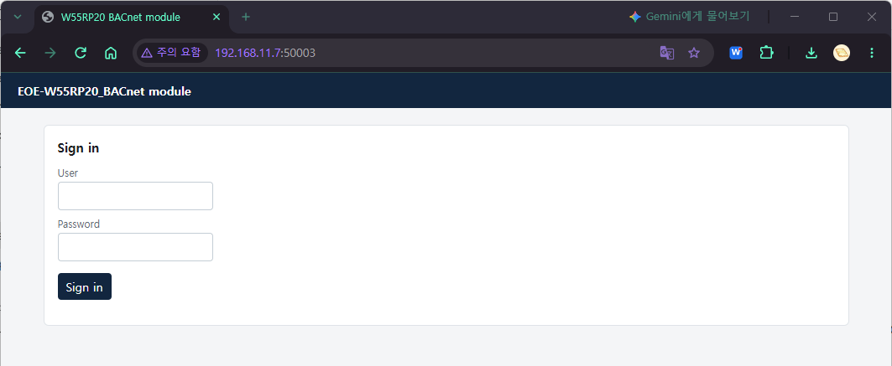

> **The port is 50003, not 80.** If you enter only the address, the browser goes to
> port 80, gets no response, and the web interface looks as if it were off.

### Step 3: Upload the file

1. Click the `Firmware` tab at the top.

   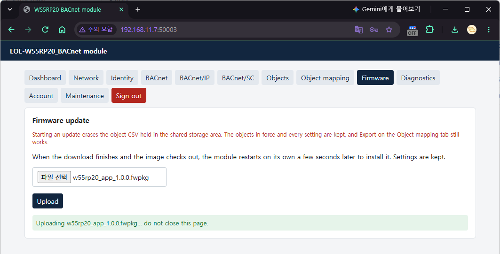

2. Click the file selection button and choose `w55rp20_app_1.0.0.fwpkg`.

   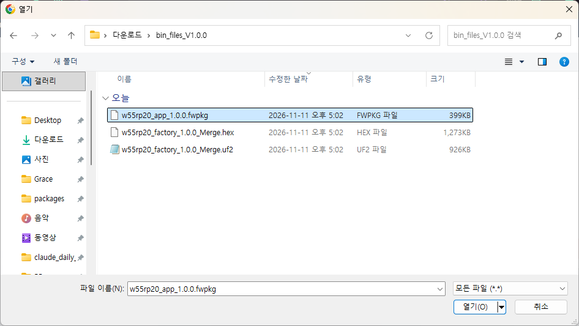

3. Click `Upload`.
4. A confirmation prompt appears. Check the file name and click OK to start the upload.
   Cancel uploads nothing.

   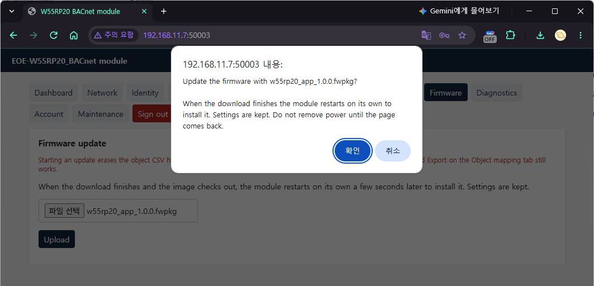

5. While the file is uploading, `Uploading ... do not close this page.` is shown. Do not
   close or reload the page.

   

### Step 4: Automatic restart and installation

When the file passes its checks, a `Download complete` box appears in the middle of the
page and counts down to the restart.

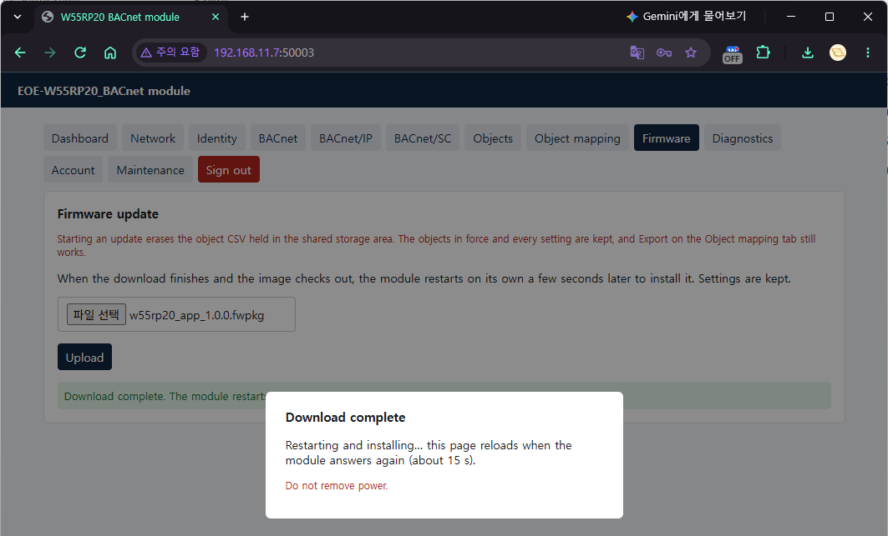

When the countdown ends, the module reboots by itself and installs the new firmware.
There is nothing else to click. The web interface does not respond in the meantime and
the box shows `Restarting and installing...`. Do not turn the power off while it is
installing.

### Step 5: Check

When the module answers again (about 15 seconds), the page reloads by itself and shows
the login screen.


Log in again and check the following on the `Dashboard` tab.

| Item | Value |
|---|---|
| `firmware` | The new version (for example `1.0.0`) |
| `ota_state` | `IDLE` |

On a workstation, the Firmware_Revision of the Device object changes to the same value.

> **To stop before the restart**, send `AT+OTACANCEL` on the AT port during the
> countdown. The received file is discarded and the module does not restart.

### If the upload is refused

If `Upload rejected (<code> <reason>)` appears, the file is not installed and the module
does not restart. The firmware that is running now is unchanged, so fix the cause and
start again from step 3.

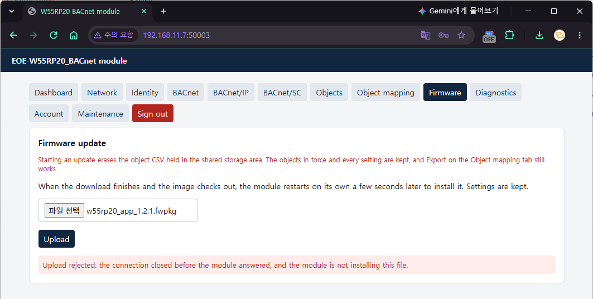

| Shown | What to check |
|---|---|
| `400 Rejected Package` | Make sure it is a `.fwpkg` file and that it is for this module. A file for another product is refused |
| `422 Image CRC Mismatch` | The file is damaged. Download the file again and upload it |
| `422 Not An Application` | The file is intact but is not firmware this module can run. Make sure it is the correct `.fwpkg` file |
| `409 Storage Busy` | An update is running on the AT port, or a CSV file is being uploaded or re-applied. Upload again when it has finished |
| `400 Truncated …` · `Transfer Incomplete` | The file did not arrive in full. Upload it again |
| `400 Overlong Payload` | The file is longer than its header says. Download the original `.fwpkg` again and upload it |
| `500 Storage Failure` | The module could not write the file to flash. Upload it again, and contact WIZnet if it keeps happening |
| `Upload rejected: the connection closed before the module answered …` | The connection to the module was lost during the upload, and the module does not install this file. A file for another product, or a file with extra data at its end, also shows this, because the module refuses it at once (the picture above). `No reply: …` may show for a moment before this message appears. Make sure the `.fwpkg` is for this module, then reload the page and upload again, or update with [method 2](#uart) (AT commands) |

---

<a id="uart"></a>

## Method 2: AT commands (UART)

This section uses the terminal program Tera Term as the example. Menu names are those of
the English interface. With another terminal program the steps are the same: use its
function that sends a file unchanged (binary transfer).

### Step 1: Set up Tera Term

In `Setup` → `Serial port...`, match the settings of the module's AT port. The values
below are the factory defaults.

| `Setup` → `Serial port...` | Serial port setup dialog |
|---|---|
| 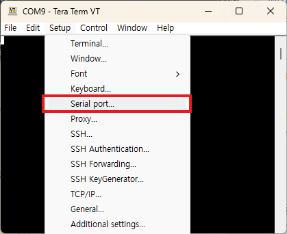 | 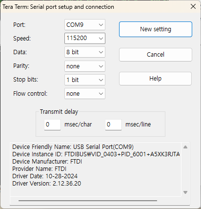 |

>
| Item | Value |
|---|---|
| Speed | 115200 |
| Data | 8 bit |
| Parity | none |
| Stop bits | 1 bit |
| Flow control | none |
| Transmit delay | 0 msec/char, 0 msec/line |

In `Setup` → `Terminal...`, set the following.

| `Setup` → `Terminal...` | Terminal setup dialog |
|---|---|
| 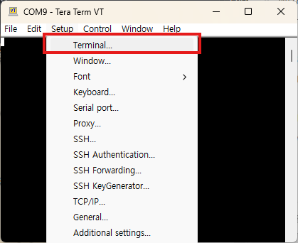 | 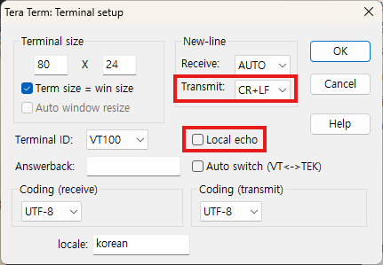 |

>
| Item | Value | Why |
|---|---|---|
| New-line, Transmit | CR+LF | AT command lines end with `CRLF` |
| Local echo | Unchecked | If it is on, the contents of the file are printed on the screen while it is sent, and the screen is garbled |

Type `AT` and check that `OK` comes back. The module does not echo what you type, so the
commands you type do not appear on the screen; only the responses do.

> **Some port settings prevent an update.** With 7 data bits or `XONXOFF` flow control
> the firmware file cannot be sent intact, so the module does not start the transfer
> (`+OTAFWUP:ERROR,PORT,"…"` and `ERROR:NOT_SUPPORTED`). Use `AT+UART` to change to 8 bits and
> one of the flow controls `NONE`, `RTSCTS` or `DTRDSR`, then `AT+SAVE` and restart with
> `AT+REBOOT` (port settings change only at a restart), set Tera Term to the same settings, and
> continue.

### Step 2: Start the transfer

Enter the following command. `60` is how long the module waits for data, in seconds.
Any value from 1 to 600 can be used.

```text
AT+OTAFWUP=60
+OTAFWUP:READY
```

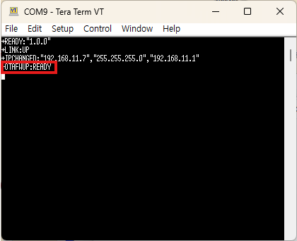

`+OTAFWUP:READY` means the module is ready to receive the file. On receiving the command the
module first erases the spare area, so this line appears about 2 seconds later. Anything sent
before this line loses its first part, so always wait for it.

If nothing arrives for 60 seconds after `READY`, the module cancels the transfer and
returns to command mode. Start step 3 within that time.

> **Do not type anything after `READY`.** From this point every byte that arrives is
> treated as firmware data. A single Enter changes the first byte of the file, and the
> transfer is refused.

### Step 3: Send the file (binary transfer)

1. Click `File` → `Send file...`.
2. Choose `w55rp20_app_1.0.0.fwpkg`.
3. Check the `Binary` option.

   | `File` → `Send file...` | Choosing the file and checking Binary |
   |---|---|
   | 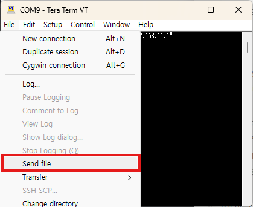 | 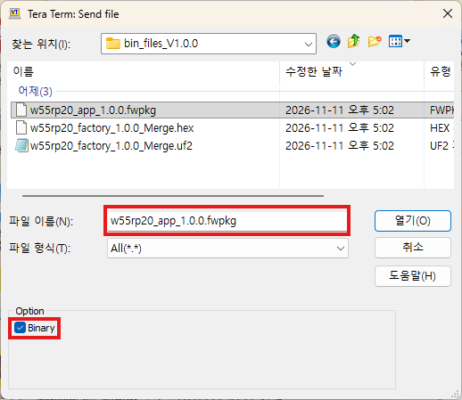 |

   >
4. Click Open (or OK) to start the transfer.

> **Always check Binary.** Without it, Tera Term sends the file as text, changing the
> line-break characters (CR, LF) or leaving some bytes out. The file then does not arrive
> as it was, and the module refuses it with an error such as `IMAGECRC` or `TIMEOUT`.

Tera Term shows a progress window during the transfer. Wait until it closes. At 115200 bps
this takes about 40 seconds.

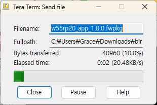

### Step 4: Check that the transfer completed

When the transfer is finished, the screen shows these three lines. The first one (`IMAGE`) already appeared early in the transfer, right after the start of the file was received.

```text
+OTAFWUP:IMAGE,1.0.0,408188
+OTAFWUP:DONE,408188,1.0.0
OK
```

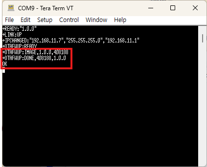

| Line | Meaning |
|---|---|
| `+OTAFWUP:IMAGE,<version>,<size>` | The start of the file (the header) passed its checks. Appears early in the transfer |
| `+OTAFWUP:DONE,<size>,<version>` | The whole file arrived, passed its checks and is stored in the spare area |

After `DONE` and `OK` the file is ready. It is not installed yet.
**Unlike the web method, the module does not restart by itself: send `AT+OTAREBOOT` in step 5 to install it.**
You can also check the state with the following command.

```text
AT+OTASTATUS?
+OTASTATUS:READY,408188,408188,100
```

### Step 5: Reboot to install

```text
AT+OTAREBOOT
OK
```

The module installs the new firmware as it reboots. When the installation has finished
and the module has started again, it sends a line with the new version.

```text
+READY:"1.0.0"
```

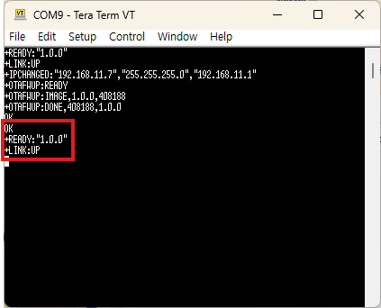

### Step 6: Check

```text
AT+VERSION?
+VERSION:"1.0.0","EOE-W55RP20_BACnet","EOE-W55RP20_BACnet-0008DC123456",0x454F4502
```

If the first field shows the new version, the update is complete.

### If an error occurs

On an error the module sends `+OTAFWUP:ERROR,<reason>` and `ERROR:<code>`, then returns to
command mode. The firmware that is running now is unchanged, so fix the cause and start
again from step 2.

| Reason | Meaning | What to do |
|---|---|---|
| `MAGIC` | Not a firmware package | Make sure you chose the `.fwpkg` file and did not press a key after `READY` |
| `HEADERCRC` | The start of the file is damaged | Check that Binary is checked, and download the file again |
| `PRODUCT` | The file is for another product | Make sure the file is for this module. The two values that follow are the product IDs of the file and of the module |
| `IMAGECRC` | The received contents failed the check | Check that Binary is checked, and download the file again |
| `NOTAPP` | The file is intact but is not firmware this module can run | Make sure it is the correct `.fwpkg` file |
| `TIMEOUT,<received>,<total>` | The file did not arrive in full | Check that the transfer started within the time set in step 2 and that Binary is checked |
| `TIMEOUT,<received>,<total>,OVERRUN` | The PC sent everything but the module missed part of it | Lower the baud rate or use `RTSCTS` flow control |
| `PORT` | The transfer cannot run with the current port settings | Check the port settings in step 1 |
| `BUSY` | An update, or a CSV upload or re-apply, is running from the web interface | Try again when it has finished |

For other reasons, see [chapter 13 of the AT Command Guide](./at-command-guide-en.md#sec-13).

- If the transfer seems to have stopped, do not press any key; wait. When the time set in
  step 2 has passed, the module sends `TIMEOUT` and returns to command mode by itself.
- A few `ERROR:INVALID_COMMAND` lines may follow an error. They are the rest of the file
  being read as commands. Press Enter once to clear them.
- The AT method erases the spare area when the transfer starts. If the transfer fails, an
  image received earlier is gone as well. The running firmware is not affected.

---

<a id="note"></a>

## Good to know

- Once a file has been received (`READY`), any reboot installs the new firmware:
  `AT+REBOOT`, Reboot on the web interface, ReinitializeDevice from a workstation, or turning
  the power off and on.
- After a web upload the module reboots by itself a few seconds later; after an AT
  transfer it waits for the host to reboot it.
- To discard a received file without installing it, send `AT+OTACANCEL` before rebooting.
- A factory reset is not possible while a received file is waiting. Install or cancel it
  first.
- The start reason reported for the first start after an update (`+DIAG:RESET` in `AT+DIAG?`, and
  the Device's Last_Restart_Reason) is that of the reboot that led to the installation.

---

## Related documents

| Document | When to read it |
|---|---|
| [AT Command Guide](./at-command-guide-en.md) | Chapter 13. Details of `AT+OTAFWUP` and the other update commands |
| [Getting Started Guide](./getting-started-en.md) | Connecting the module, setting the IP address, turning on the web interface |
