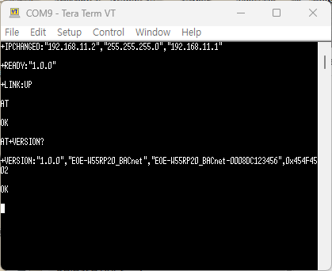
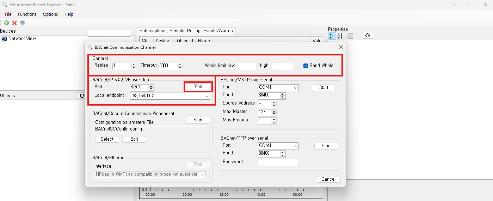
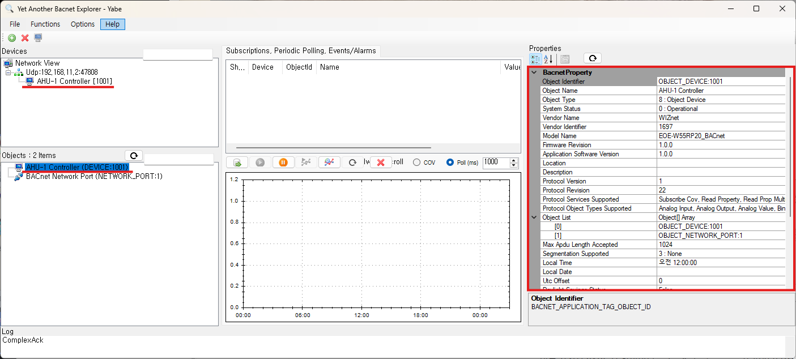
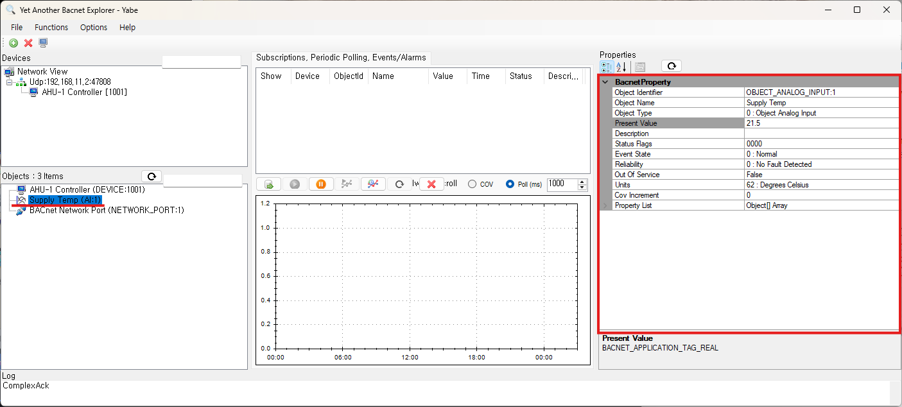
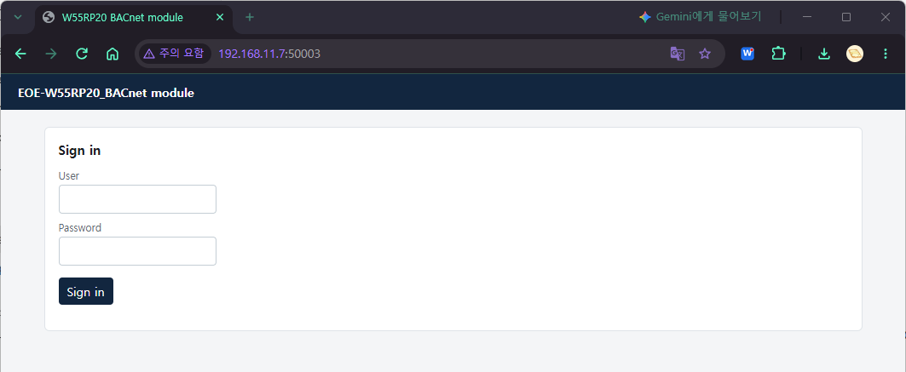
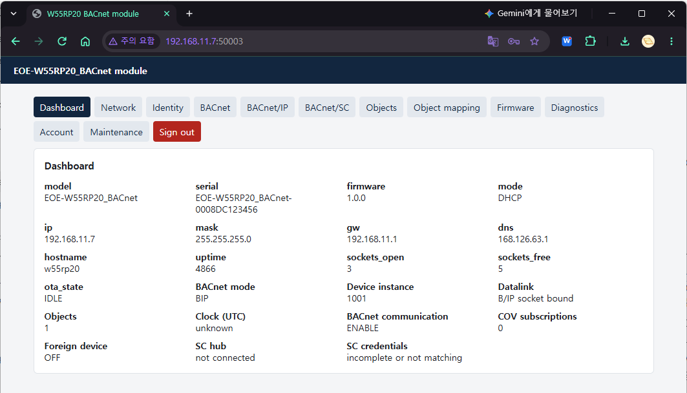

# EOE-W55RP20_BACnet Module Getting Started Guide

<p style={{textAlign: 'right'}}>Firmware 1.0.0</p>

This guide takes a new module to the point where it talks to a BACnet workstation, in four steps.

| Step | Contents |
|---|---|
| [Step 1](#step1) | Wiring |
| [Step 2](#step2) | Check that the module answers |
| [Step 3](#step3) | Set the IP address |
| [Step 4](#step4) | Turn on BACnet and find the device from a workstation |

The firmware is already written to the module. The MAC address and serial number are
written during production, so there is nothing to enter.

This guide covers the shortest path: BACnet/IP with a workstation on the same subnet. For
BACnet/SC (hubs and certificates) or a workstation on another subnet, see
the [BACnet Setup Guide](./bacnet-setup-guide-en.md).

---

## What you need

- A module running the BACnet firmware: one of
  [WIZ-IP20](https://docs.wiznet.io/Product/Modules/Serial-to-Ethernet-Module/WIZ-IP20),
  [W232N](https://docs.wiznet.io/Product/Modules/Serial-to-Ethernet-Module/W232N) or
  [EOE-W55RP20](https://docs.wiznet.io/Product/Modules/EOE/EOE-W55RP20)
- A USB-to-serial adapter, to connect the module's AT port to a PC
- An Ethernet cable and a PC on the same network as the module
- A terminal program such as Tera Term or PuTTY
- A BACnet workstation, used in step 4. The examples in this guide use **YABE**
  (Yet Another BACnet Explorer) 2.1.0, a free tool for Windows

---

<a id="step1"></a>

## Step 1: Wiring

AT commands are exchanged on UART1.

| Connection | EOE-W55RP20 | WIZ-IP20 | Other side |
|---|---|---|---|
| AT port TX | GP4 | P5 (TXD) | RX of the USB-serial adapter |
| AT port RX | GP5 | P3 (RXD) | TX of the USB-serial adapter |
| GND | GND | P9 (GND) | GND of the USB-serial adapter |
| Ethernet | RJ-45 | RJ-45 | Switch or PC |

The EOE-W55RP20 and WIZ-IP20 pins are 3.3 V TTL, so use a 3.3 V USB-serial adapter.

On the W232N, connect its RS232 port (DB9) to the PC's RS-232 port.

> **Cross TX and RX.** The module's TX goes to the other side's RX. If the two wires are
> swapped nothing answers, which is the most common mistake on a first connection.

The flow control pins (GP6 CTS · GP7 RTS on the EOE-W55RP20, P6 CTS · P10 RTS on the WIZ-IP20) do not
need to be connected. The factory
default uses no flow control, and it can be turned on later with `AT+UART`.

The module boots as soon as power is applied.

---

<a id="step2"></a>

## Step 2: Check that the module answers

Open the terminal with these settings.

| Item | Value |
|---|---|
| Speed | 115200 |
| Data bits · parity · stop bits | 8 · none · 1 |
| Flow control | None |
| Line ending (transmit) | CR+LF |

When booting finishes, the module sends this line:

```text
+READY:"1.0.0"
```

If you missed it, that is fine. Type `AT` and press Enter.

```text
AT
OK
```

`OK` means the connection works. The module does not echo what you type, so the commands you
type do not appear on the screen; only the responses do (to see them, turn on Local echo in the
terminal). If nothing comes back, see [Troubleshooting](#trouble).

Next, check what the device is:

```text
AT+VERSION?
+VERSION:"1.0.0","EOE-W55RP20_BACnet","EOE-W55RP20_BACnet-0008DC123456",0x454F4502
```

The fields are firmware version, model, serial number and product ID. The last part of the
serial number is the module's MAC address, so it differs from module to module.



### Checking status with the pins

To check the state from the board alone, without a PC, look at these output pins.

| EOE-W55RP20 | WIZ-IP20 | W232N | When high |
|---|---|---|---|
| GP10 | P13 (LINKLED) — when **low** | LINK LED on | The Ethernet link is up |
| GP11 | None | TCP LED on | At least one TCP connection exists on the AT socket channels |
| GP9 (DSR) | None | DB9 pin 6 (DSR) | The module is ready for AT commands |

The WIZ-IP20's P13 (LINKLED) is an LED signal driven directly by the Ethernet chip, so it goes
**low** when the link is up. The WIZ-IP20 has no TCP connection or DSR pin. Check TCP connections with
`AT+SOCKSTATUS?`, and whether the module is ready for commands with the `+READY` line at boot.

---

<a id="step3"></a>

## Step 3: Set the IP address

From the factory the module uses the static IP `192.168.11.2`.

> If the PC is on a different subnet it cannot reach the module. Change the module's
> address as shown below, or put the PC in the `192.168.11.x` range.

To use DHCP:

```text
AT+NETMODE=DHCP
AT+SAVE
```

To use a static address:

```text
AT+NETMODE=STATIC
AT+IP="192.168.0.100"
AT+MASK="255.255.255.0"
AT+GW="192.168.0.1"
AT+SAVE
```

> **Do not forget `AT+SAVE`.** Set commands only record the value in memory; `AT+SAVE`
> stores and applies it. This is the most common mistake.

Check the address in use. An address obtained by DHCP is shown by this command too.

```text
AT+IP?
+IP:"192.168.0.100"
```

Step 3 is done when the module answers `ping` from the PC.

```bash
ping 192.168.0.100
```

---

<a id="step4"></a>

## Step 4: Turn on BACnet and find the device from a workstation

### Turn on BACnet

From the factory BACnet is off. This keeps a device that has not been configured from appearing
on the network; in this state the module does not answer a workstation's Who-Is at all.

Turn on BACnet/IP and set the Device instance and name.

```text
AT+BACMODE=BIP
AT+BACDEV=1001,"AHU-1 Controller"
AT+SAVE
```

| Value | Meaning |
|---|---|
| `BIP` | The module operates as BACnet/IP. BACnet/SC, which goes through a hub, is `SC` |
| `1001` | Device instance. Use a number from 0 to 4194302 that no other device on the network uses |
| `"AHU-1 Controller"` | Device name (Object_Name). Up to 31 bytes |

If you do not set the instance, a number derived from the MAC address and a name of the form
`EOE-W55RP20_BACnet-XXXXXX` are used. The number comes from the low 22 bits of the MAC address, so
it rarely collides, but on a site a fixed number is usually assigned.

Check that it is running.

```text
AT+BACMODE?
+BACMODE:BIP,RUNNING
AT+BACDEV?
+BACDEV:1001,"AHU-1 Controller"
```

`RUNNING` means the module is answering BACnet/IP on UDP 47808.

> If `AT+BACDEV?` shows an extra `+BACDEV:APPLIED,…` line, the settings differ from the values
> the module is answering with now. The line can remain for a moment right after `AT+SAVE`. If it
> is still there a little later, `AT+SAVE` was not sent.

### Find the device with YABE

1. Start YABE and click **Functions → Add BACnet Channel** (the same as the **Add Channel**
   button on the toolbar). The **BACnet Communication Channel** window opens.
2. In the **General** box at the top of the window, change **Timeout** to `3000`. Leave **Send
   WhoIs** checked.
3. In the **BACnet/IP V4 & V6 over Udp** box, leave Port at `BAC0` (47808 in hexadecimal). For
   **Local endpoint**, choose the PC address in the same range as the module.
4. Click **the Start in that box** (to the right of the Port line). The window has five Start
   buttons; be sure to click the one in the BACnet/IP box.

   

5. A Udp channel appears under `Network View` in the **Devices** tree at the top left, and within
   a few seconds Device **1001** appears under it.
6. Click Device 1001, and the Device object and the Network Port object appear in the **Objects**
   pane at the bottom left. Click the Device object to show its properties in the **Properties**
   pane on the right.

   

When the Properties pane shows the following, communication is confirmed.

| Property | Value |
|---|---|
| Object Name | `AHU-1 Controller` |
| Vendor Identifier | `1697` |
| Model Name | `EOE-W55RP20_BACnet` |
| Firmware Revision | `1.0.0` |

> **Why the Timeout is changed to 3000.** YABE's default of 500 ms is shorter than the time the
> module waits for the host's approval of a confirmed write (750 ms). Change `DefaultTimeout` to
> 3000 in **Options → Settings** and it becomes the default for this window.

> If a Windows Firewall prompt appears the first time YABE runs, **allow** YABE's traffic. If it
> is not allowed, the module's responses do not reach YABE and the device does not appear.

### Publishing a value

The shortest way to publish a value from your device over BACnet:

```text
AT+BOBJADD=AI,1,"Supply Temp",degrees-celsius
AT+SAVE
AT+BOBJVAL=AI,1,21.5
```

| Command | Meaning |
|---|---|
| `AT+BOBJADD` | Creates Analog Input 1, with degrees Celsius as its unit. An object is visible on the network as soon as it is created |
| `AT+SAVE` | Stores the object definition. Without it the object is gone after a reboot |
| `AT+BOBJVAL` | Sends the value. No `AT+SAVE` needed |

Click Device 1001 in YABE again, and `Supply Temp` appears in the Objects pane. Click it: its
Present Value is `21.5`. Each time the value changes, send `AT+BOBJVAL=AI,1,<new value>`.



The nine object types, objects that a workstation writes, confirmed objects whose writes the host
approves, and how to create many objects at once with a CSV file are in chapter 4 of
the [BACnet Setup Guide](./bacnet-setup-guide-en.md).

---

<a id="trouble"></a>

## Troubleshooting

### Nothing answers `AT`

| Check | Details |
|---|---|
| TX/RX direction | The module's TX (GP4 on the EOE-W55RP20, P5 on the WIZ-IP20, DB9 pin 3 on the W232N) must go to the other side's RX |
| Speed | The factory default is 115200. A board used elsewhere may have been changed |
| Port | AT commands are accepted only on UART1 (GP4/GP5 on the EOE-W55RP20, P5/P3 on the WIZ-IP20, the RS232 port on the W232N). The EOE-W55RP20's GP0/GP1 carry the debug log only |
| Flow control | If only the PC side has it on, the link looks frozen. Turn it off on both sides |
| Line ending | A command runs only when a line ending (CR, LF or CR+LF) arrives. Check that the terminal sends one on Enter |
| GND | Without a GND connection, communication is unreliable |

If nothing works, hold the EOE-W55RP20's FACT RSTn pin (GP18) low for 5 seconds or more to perform
a factory reset. The AT port returns to 115200 8N1 with no flow control. On the W232N, use the factory
reset switch inside the case. The WIZ-IP20 does not have this pin; if the web interface was left on,
use Factory reset on its Maintenance tab.

> **A factory reset clears all settings.** Network settings, BACnet settings, objects and stored
> values, and BACnet/SC certificates are all reset. The MAC address, serial number and product ID
> are kept.

### The device does not appear in the workstation

1. BACnet: `AT+BACMODE?` must return `+BACMODE:BIP,RUNNING`. The factory default is
   `OFF`. Check that `AT+SAVE` was sent after `AT+BACMODE=BIP`.
2. Address: `AT+IP?` reports the address the module is actually using. It must be on the same
   subnet as the PC and answer `ping`.
3. YABE channel: if the Devices tree shows only a COM port name such as `COM3`, the Start that was
   clicked in the channel window was not the one in the BACnet/IP box. Right-click that channel →
   **Remove Channel/Device** to delete it, and do step 4 again. Also check that the Local endpoint
   is an address in the same range as the module.
4. PC: check that Windows Firewall is not blocking YABE, and that no other BACnet program using
   UDP 47808 is running on the same PC. On one PC, only one program can use 47808.
5. A network that blocks broadcasts: use YABE's **Functions → IP Services → Send unicast WhoIs**
   to send a Who-Is directly to the module's IP address.

### Settings or objects disappear after a reboot

Most likely `AT+SAVE` was not sent. Set commands and `AT+BOBJADD` survive a reboot only after
`AT+SAVE`.

### `AT+BOBJVAL` returns `ERROR:ACCESS_DENIED`

For an object with a priority array, such as an Analog Output, the workstation's commands set the
value, so the host cannot write it. Otherwise, a workstation has put that object Out_Of_Service.
Check the object's flags with `AT+BOBJ?`.

---

## Using the web interface

The web interface is disabled by default, so that an unconfigured device is not exposed
on the network. It can be turned on only with an AT command.

From the factory there is no web password, so no one can log in. When turning the web
interface on, also set a password with `AT+WEBPASS`. The password must be at least 8
characters. The web commands are:

```text
AT+WEB=1                 enable the web interface
AT+WEB=0                 disable
AT+WEB=1,600             enable + session timeout of 600 s (1 … 65535)
AT+WEB?                  → +WEB:1,600,SET   (MUSTCHANGE until a password is set)

AT+WEBUSER="admin"
AT+WEBUSER?              → +WEBUSER:"admin"

AT+WEBPASS="new-password"   8 … 63 bytes
AT+WEBTIMEOUT=600        1 … 65535 s
AT+WEBTIMEOUT?           → +WEBTIMEOUT:600
AT+SAVE
```

On the login page, enter the account name (factory default `admin`) in User and the password
set with `AT+WEBPASS` in Password.

Open it in a browser.

```text
http://192.168.0.100:50003/
```

> **The port is 50003, not 80.** If you enter only the address, the browser goes to
> port 80, gets no response, and the web interface looks as if it were off.



After you sign in, the Dashboard tab opens. Use the tab row at the top to move to the other pages.



> **The web interface is HTTP.** Passwords travel unencrypted, so use it on a trusted network
> only. When you have finished, click **Sign out** at the end of the tab row.

On the web interface you can configure BACnet, view the object list, register many objects at
once with a CSV file, upload BACnet/SC certificates, update the firmware and check diagnostics.
Each tab is described in chapter 2 of the [BACnet Setup Guide](./bacnet-setup-guide-en.md).

---

## Where to go next

| Document | Read it when |
|---|---|
| [BACnet Setup Guide](./bacnet-setup-guide-en.md) | Defining objects in detail, or setting up BACnet/SC, Foreign Device registration, time or passwords |
| [AT Command Guide](./at-command-guide-en.md) | Looking up the arguments and responses of a command |
| [Product Overview](./BACnet.mdx) | Getting an overview of the product's features |
| [Firmware Update Guide](./firmware-update-guide-en.md) | Updating the firmware of a running module |
