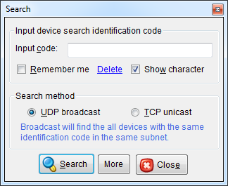

-----

W5500S2E Series is one of WIZnet’s Serial to Ethernet module that users can connect with any device that provides serial interface and use the Ethernet network to control and monitor.

W5500S2E can be used in has configuration tools, AT command through serial terminal and website configuration to configure all the features in the modules. 

**This document explains the key feature to create a TCP/UDP connection between a PC with your serial device.** 

-----

## Network Settings

### IP Address Allocation Settings

W5500S2E modules provides **two kinds of IP address allocation method** for assigning the IP address. The allocation of IP address includes the IP address, Gateway address, Subnet mask, and DNS server address.

  - **Static(Manual) IP allocation**
      - Also known as the static allocation; the product will operate according to the network information entered by the user. Both the public IP address and private IP address can be assigned.
      - In cases of using TCP client, the DNS address must be set if the remote host\[1\] is a domain name\[2\] and not an IP address.
      <!-- - Please refer to the example for assigning a private IP address. "Need to modify after the quick start guide has been made"-->

  - **Automatic IP allocation (DHCP)**
      - This method will automatically assign the IP address integrated in the NAT Router via the DHCP server. Users do not need to do any settings, and devices using the assigned IP from the same router can communicate with each other. Usually a private IP address\[3\] from the dynamic IP allocation range\[4\] is assigned, but there are cases when a public IP is assigned((Example) When an IP address is assigned by an ISP (Internet Service Provider).
      - The DHCP server assigns the IP address, Gateway address, Subnet mask, and DNS address.
          - In cases of using a router, W5500S2E module can be used in TCP client mode to sync with the external server.
          - In cases of using TCP server mode, users need to set the router’s [port forwarding](https://en.wikipedia.org/wiki/Port_forwarding) for access of external network.

**<u>IP address allocation settings</u>**

**Config Tool & webpage configuration location:**

| Tools                 | Settings | Location                              |
| --------------------- | -------- | ------------------------------------- |
| Config Tool           | All      | Basic Settings Tab - Network Settings |
| Webpage Configuration | All      | Basic Settings Tab - Network Settings |

**Settings:**

| Modes  | AT Command   | Config Tool                                                                        | Webpage Configuration | Default                                 |
| -----  | ------------ | ---------------------------------------------------------------------------------- | --------------------- | --------------------------------------- |
| Static | AT+IP_MODE=0 | <u>**Select**</u>: Use the Follow IP Address       | Use DHCP (uncheck)    | 

 |
| DHCP   | AT+IP_MODE=1 | <u>**Select**</u>: Get IP Address from DHCP Server | Use DHCP (checked)    |                                         |

**Default IP Addresses:**

| Type          | AT Command  | Config Tool                                    | Webpage Configuration | Default         |
| ------------- | ----------- | ---------------------------------------------- | --------------------- | --------------- |
| IP Address    | AT+IP       | Modify and display in **IP address** text box  | Same as Config Tool   | 192.168.1.88    |
| Subnet Mask   | AT+MARK     | Modify and display in **Subnet Mask** text box | Same as Config Tool   | 255.255.255.0   |
| Gateway       | AT+GATEWAY  | Modify and display in **Gateway** text box     | Same as Config Tool   | 192.168.1.1     |
| DNS Server    | AT+DNS      | Modify and display in **DNS Server** text box  | Same as Config Tool   | 114.114.114.114 |

**Reference:**

[1]  Remote host means the destination where the serial device is sending data via the network

[2]  Example: www.google.com

[3]  Typically will look like 192.168.xxx.xxx in the IPv4 class C range

[4] Typical router will separate the external IP address for communication with external network and the internal IP address for internal network via router
    
---

### Port Number Settings

A port number is a way to identify the process of communication between the TCP and UDP protocol and is a 16 bit integer. Port numbers are managed by IANA\[1\] and are used along with the IP address to separate the protocol and application.

The range of port numbers are 0 \~ 65535.

  - **0 \~ 1023**: Well-known port
      - Numbers that are assigned to protocols
      - ex) \[HTTP (web server)\] TCP 80, \[DNS\] TCP/UDP 53, \[DHCP\] UDP 67 and Etc.

  - **1024 \~ 49151**: Registered port
      - Numbers that are assigned to vendor’s applications

  - **49152 \~ 65535**: Dynamic port

The specified port numbers are not mandatory but recommended by IANA for smooth network communication. Registered port numbers are recommended for the user’s application or dynamic port numbers are recommended for temporary usage.

For all registered ports, please refer to the [default list](wizse_at_command_s1#appendix).

**<u>Port number settings</u>**

**Config Tool & Webpage configuration location:**

| Tools                 | Settings              | Location                                 |
| --------------------- | --------------------- | ---------------------------------------- |
| Config Tool           | Local and Remote Port | Basic Settings Tab - Socket Settings     |
| Config Tool           | Webpage Port          | Basic Settings Tab - Addtional Functions |
| Webpage Configuration | Local and Remote Port | Channel 1 Tab - Connection               |
| Webpage Configuration | Webpage Port          | Addtional Options Tab - Device Options   |  

**Settings**

| Type         | AT Command    | Config Tool                                                 | Webpage Configuration                          | Default |
| ------------ | ------------- | ----------------------------------------------------------- | ---------------------------------------------- | ------- |
| Local Port   | AT+C1_PORT    | Modify and display in **Local Port** text box               | Same as Config Tool                            | 5000    |
| Remote Port  | AT+C1_CLI_PP1 | Modify and display in **Remote Host** second text box       | Modify and display in **Remote Port** text box | 5000    |
| Webpage Port | AT+WEB_PORT   | Modify and display in **Embedded Web Server Port** text box | Modify and display in **HTTP Port** text box   | 80      |

**Reference:**

1.  Internet Assigned Numbers Authority, http://www.iana.org

-----

### Remote Host Settings

When the W5500S2E is operated in TCP client mode\[1\], the TCP connection to the remote host is done in a fixed interval\[2\] of time, and also 'Remote host' means peer's network information\[3\] when the W5500S2E is operated in UDP mode. Remote host field can set the 'IP address' or 'domain name' by configuration tool.

In cases of the remote host being set as the domain name, the integrated DNS client can automatically change the domain name to an IP address and operate a TCP connection with the destination.

Registered port numbers are recommended for the user’s application.

**<u>Remote Host settings</u>**

**Config Tool & Webpage configuration location:**

| Tools                 | Settings | Location                              |
| --------------------- | -------- | ------------------------------------- |
| Config Tool           | All      | Channel 1 Tab - Connection            |
| Webpage Configuration | All      | Basic Settings Tab - Socket Settings  |  

**Settings**

| Type                         | AT Command    | Config Tool                                                        | Webpage Configuration                           | Default                                       |
| ---------------------------- | ------------- | ------------------------------------------------------------------ | ----------------------------------------------- | --------------------------------------------- |
| Remote Host (IP address)     | AT+C1_CLI_IP1 | Modify and display in **Remote Host** first text box               | Same as Config Tool                             | 192.168.11.99                                 |
| DNS Enable                   | AT+DNSEN      | Automatically turns on after setting domain name in **Remote Host**| Same as Config Tool                             | Disabled                                      |
| Domain Name                  | AT+DOMAIN     | Modify and display in **Remote Host** first text box               | Modify and display in **Remote Host** text box  | iwiznet.cn                                    |

**Reference:**

1.  TCP client mode or TCP server/client mixed mode

2.  Reconnection interval value

3.  In UDP 1:1 mode, data sent from an unspecified remote host are all discarded

-----
    
## Network Operation Mode

W5500S2E supports four kinds of operation modes based on the network; **TCP server mode, TCP client mode, UDP mode and Modbus mode**. Users can select the network operation mode according to the feature and purpose of the serial device. Each operation modes are explained in detail below.

-----

### TCP Server Mode

The module operates as below in TCP server mode.

1.  **Waits for the connection request from TCP client (listen)**
2.  **Connects with TCP client once connection request is accepted (TCP connection established)**
3.  **Data communication**

There is an optional feature in TCP server mode.

  - **Connection password**
      - The password must be sent from TCP client before data communication.
      - TCP connection will be disconnected if the password does not match. 

-----

### TCP Client Mode

The module operates as below in TCP client mode.

1.  **Attempts TCP connection to the designated TCP server host (TCP connect)** 
2.  **Data communication is possible after TCP connection is established**

  - Information of the designated host is needed during this mode and host must be operating as TCP server.

There is an optional feature in TCP client mode.

  - **Re-connection interval**
      - Sets the interval for TCP connection to the remote host.
      - If TCP connection is unsuccessful, connection is attempted again after the specified time is lapsed.

-----

### UDP Mode

This mode operates using UDP protocol. Unlike TCP mode, there is no connection process thus the host address setting is mandatory.

The added feature of UDP mode for WIZ750SR is that communication with multiple hosts are possible (1:N UDP mode). This feature is available only in applications where the data is sent from peer.

  - **1:1 UDP Mode**
      - Module will communicate with the specified remote host address (domain name) and port number.

  - **1:N UDP Mode**
      - Module will communicate with all the host that initiated data communication. 
      - Cannot initiate data communication.
      - This mode is recommended for applications where the serial device receives data from multiple hosts.

**1:N UDP Mode Setting**  
*Set the remote host IP address to 0.0.0.0*  
(The remote host port number must be set )

-----

## Serial Port Settings

### Baud Rate

  - The supported baud rates for Data UART are as below.

| Baud rate(bps) | Remarks |
| -------------- | ------- |
| 300            | \-      |
| 600            | \-      |
| 1200           | \-      |
| 1800           | \-      |
| 2400           | \-      |
| 4800           | \-      |
| 9600           | \-      |
| 14400          | \-      |
| 19200          | \-      |
| 28800          | \-      |
| 38400          | \-      |
| 57600          | \-      |
| **115200**     | Default |
| 230400         | \-      |

### Data Bit

  - The supported data bits are as below.

| Data Bit | Remarks |
| -------- | ------- |
| 7        | \-      |
| **8**    | Default |

### Parity Bit

  - The supported parity bits are as below.

| Parity Bit | Remarks |
| ---------- | ------- |
| **NONE**   | Default |
| ODD        | \-      |
| EVEN       | \-      |

### Stop Bit

  - The supported stop bits are as below.

| Stop Bit | Remarks |
| -------- | ------- |
| **1**    | Default |
| 2        | \-      |

### Flow Control

  - RS-232/TTL versions support the below serial data flow control.

| Flow Control | Description              | Remarks |
| ------------ | ------------------------ | ------- |
| NONE         | Do not use flow control. | Default |
| XON/XOFF     | Software flow control    | \-      |
| CTS/RTS      | Hardware flow control    | \-      |

  - RS-422/485 versions will operate as ‘NONE’ shown above no matter which option is selected.

### Etc.

  - The supported baud rates for Debug UART are as below.

<table>
<thead>
<tr class="header">
<th>Serial Settings</th>
<th>Remarks</th>
</tr>
</thead>
<tbody>
<tr class="odd">
<td>115200-8-N-1:NONE</td>
<td>Default, setting fixed 
Flow control disabled</td>
</tr>
</tbody>
</table>

-----

## Options

### Debug Message

  - By enabling this option, the product information or error status can be printed via the Debug UART.
  - The serial settings of the Debug UART is fixed as **115200-8-N-1:None**.

### Serial Command Mode Switch Code

  - This is a 3-byte code for switching the mode from data mode to serial command mode.
      - Enable default: Enabled
      - Default values: \[2B\]\[2B\]\[2B\] (+++)
  - Use the serial command mode composed of 2-byte to change settings.
  - The existing TCP connection will be lost if the mode changes to serial command mode.
  - Each byte value reads hex code only.

:::info
**Please take caution of the following when using Trigger code.**

1.  It can only be recognized as switch code if there is a time gap of at least 500ms of no data communication time before and after the 3-byte command mode switch.
2.  The time interval for each byte of the 3-byte command mode switch code has to be at most 500ms.
3.  Do not end the command mode switch code with CR or LF.
4.  The default interval of the time gap before and after the command mode switch code is 500ms. The operation is based on the timer value of the serial data packaging option.

5.  The serial command after switching modes must end with CR and LF.
:::

### Serial Data Packing

  - WIZ750SR provides **multiple serial data packing options**. By using this option, user command frame or all other data can be collected and sent together.

Data packing options can be multi-selected but has priority as shown below.  
**Character =\> Size =\> Timer** 
  - **Timer**
      - Range: 0 \~ 65535 / Unit: milliseconds (ms)
          - Default: 0 (Not used)
      - Collects the data until the designated time is lapsed and sent together. Will not operate if set to '0'.

  - **Size**
      - Range: 0 \~ 255 / Unit: data length (number of bytes)
          - Default: 0 (Not used)
      - Collects the data until the designated data length is reached and sent together.
      - Will not operate if set to '0'.

  - **Character**
      - Range & Unit: 1-byte character (Hex code)
          - Default: 00 (Not used)
      - Collects the data until the designated character is entered and sent together.
      - The designated character will be included if the data size does not exceed the buffer size. The designated character will be excluded if the data size exceeds the buffer size.
      - Will not operate if set to '0x00'.

### Inactivity Timer

  - **Range: 0 \~ 65535 / Unit: seconds**
      - Default: 0 (Not used)
  - If inactivity timer is set, connection is lost after the designated time without data communication is lapsed after the last data is sent.
  - This setting is for **TCP Server or TCP Client mode and mixed mode**.

### Re-connection Interval

  - **Range: 1 \~ 65535 / Unit: milliseconds (ms)**
      - Default: 3000 (Use, 3 seconds)
  - The re-connection interval is for **TCP Client Operation, including TCP Client of the mixed mode**.
  - This option is requires in order to re-connect TCP communication in case it is lost.
  - The setting must be at least 1ms.

### Search Identification Code

  - **Range: Up to 8-bytes string**
      - Default: Null (Not used)
  - The search identification code is for identifying the device search.
  - If this option is selected, the assigned code must be entered when searching devices.

<table>
<tbody>
<tr class="odd">
<td></td>
</tr>
<tr class="even">
<td>Figure: <strong>Search ID code</strong> 
(UDP broadcast search)</td>
</tr>
</tbody>
</table>

### Connection Password

  - **Range: Up to 8-bytes string**
      - Default: Null (Not used)
  - Connection password is available for **TCP server mode** (including TCP server mode of the mixed mode).
  - TCP client must send the connection password character upon connecting to WIZ750SR in order for data communication.
  - TCP connection will be disconnected if the password does not match

1.  Serial data can be collected according to the setting (character, size, or time) and be sent together.

2.  In cases when there are multiple devices in the same network.

### TCP Keep-Alive

  - **Send Keep-Alive: Enable**
      - This option allows the connection status to be kept alive by sending the ‘keep-alive packet’ in **all three TCP modes**. (TCP server, TCP client, and TCP mixed mode)
          - Default: Enabled (recommended)
      - TCP connection is disconnected if there is no response to the ‘keep-alive’ packet. (Socket close / disconnect)
      - The ‘keep-alive’ packet is sent after the Ethernet packet is sent at least once from WIZ750SR.

  - **Send Keep-Alive Interval**
      - **Range: 0 \~ 65535, Unit: milliseconds(ms)**
          - Default: 7000, 5000 (recommended, 7 seconds / 5 seconds)
      - The required interval for sending the ‘keep alive’ packet is as below.
          - The time until the first ‘keep-alive’ packet is sent
          - The time interval between each ‘keep-alive’ packets

  - This option is recommended in case of a physical disconnection with the remote device.
      - This options is recommended especially in TCP server mode.

-----

## Device Setting Methods

There are two methods for the various option settings of WIZ750SR’s serial to Ethernet operation.

  - **[Setting using the configuration tool](./Configuration-Tool-Manual-New-EN.mdx) (network)**
  - **[Setting using the command set](./Command-Manual-EN.md) (serial / network)**

For more information, please refer to above document links.

-----

 **If there is any problem?**  
Please refer to our **[Troubleshooting Guide](./Trouble-Shooting-EN.mdx)**! 

-----

1.  Settings of configuration tool and command set are compatible to the settings of WIZ107/108SR except the unused and altered command information described in the [WIZ750SR Command Manual](./Command-Manual-EN.md).
